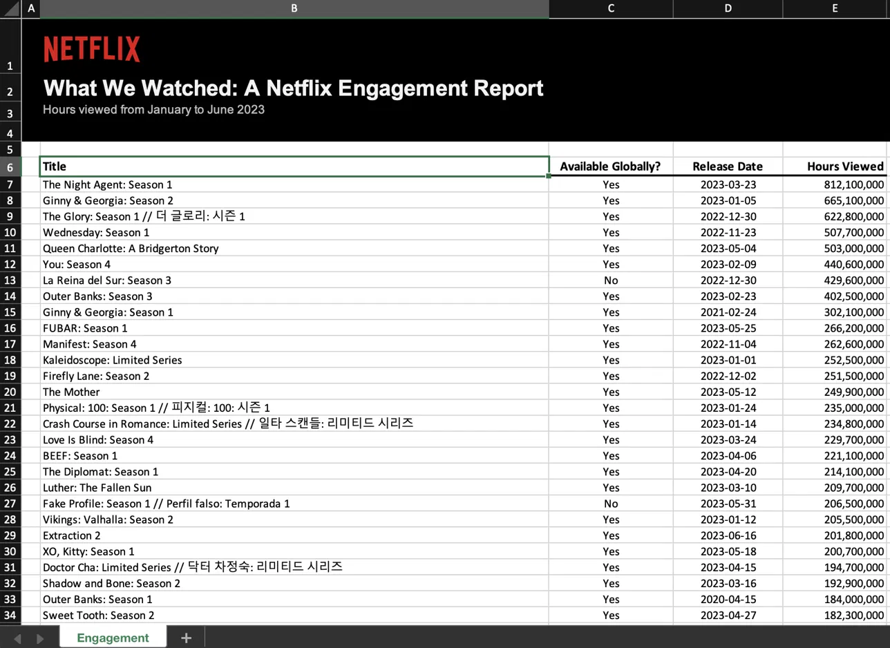
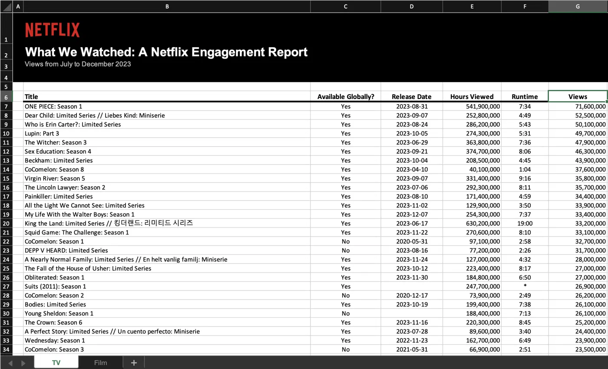

---
title: "Mini-Project 01 - What We Watched: Exploring Netflix Viewing Data"
author: "jonchan420"
editor:
  mode: source
format:
  html:
    code-fold: true
    css: styles.css 
    
---

## Introduction

Welcome to my first (graded) mini project! As you can tell, the project is Netflix themed, which I got inspired (color wise) by a classmate's Mini-Project #00.
 

Netflix spent years gatekeeping its viewership data, however advertisers wanted proof people would actually see their ads, and creators wanted a piece of that pie, so since 2023 Netflix publishes a semi annual *What We Watched* report covering nearly majority of the data that Netflix can provide. In this mini project, I dug through seven of those reports to figure out what actually captures Netflix watch time, in which I turn into a strategy memo for Netflix to figure out how to spend their 2027 content budget.

## Data Acquisition and Preparation

```{r}
#| label: load-netflix-data
#| message: false
#| warning: false

#' Acquire Netflix What We Watched Reports
#'
#' This function will acquire and standardize all data for MP#01
#' from Netflix. Because Netflix hosts the data files behind a CDN, we
#' are accessing the release pages and automatically extracting links to the
#' relevant files (with CDN hash).
#'
#' After import, files are stacked vertically and some basic cleaning is
#' performed.

load_netflix_data <- function() {

  library(tidyverse)
  library(rvest)
  library(readxl)
  library(fs)

  data_dir <- path("data", "mp01")

  if (!dir_exists(data_dir)) {
    dir_create(data_dir, showWarnings = FALSE, recurse = TRUE)
  }

  NETFLIX_URLS <- list(
    `2023H1` = "https://about.netflix.com/news/what-we-watched-a-netflix-engagement-report",
    `2023H2` = "https://about.netflix.com/news/what-we-watched-the-second-half-of-2023",
    `2024H1` = "https://about.netflix.com/news/what-we-watched-the-first-half-of-2024",
    `2024H2` = "https://about.netflix.com/news/what-we-watched-the-second-half-of-2024",
    `2025H1` = "https://about.netflix.com/news/what-we-watched-the-first-half-of-2025",
    `2025H2` = "https://about.netflix.com/news/what-we-watched-the-second-half-of-2025",
    `2026H1` = "https://about.netflix.com/news/what-we-watched-the-first-half-of-2026"
  )

  download_if_needed <- function(url, local) {
    if (!file_exists(local)) {
      download.file(url, local, quiet = TRUE, mode = "wb")
    }

    return(local)
  }

  NETFLIX_URLS |>
    map(read_html) |>
    map(html_element, xpath = "//a[contains(@href, '.xlsx')]") |>
    map_chr(html_attr, "href") |>
    enframe("period", "url") |>
    mutate(
      path = path(data_dir, paste0(period, ".xlsx")),
      path = map2(url, path, download_if_needed),
      data = map(path, read_excel, skip = 3, na = "*"),
      data = map(
        data,
        \(x) x |> mutate(`Release Date` = as.Date(`Release Date`))
      )
    ) |>
    unnest(data) |>
    select(-url, -path) |>
    mutate(
      year = str_sub(period, 1, 4),
      half = str_sub(period, start = 6),
      period_start = make_date(year, if_else(half == 1, 1, 7), 1),
      period_end = make_date(
        year,
        if_else(half == 1, 6, 12),
        if_else(half == 1, 30, 31)
      )
    ) |>
    filter(!is.na(`Hours Viewed`)) |>
    mutate(
      live_event = !is.na(Runtime) &
        str_detect(Runtime, "\\d+:\\d+\\*"),
      clean_time = str_remove(Runtime, fixed("*")),
      Runtime = 60 * hour(hm(clean_time)) + minute(hm(clean_time))
    ) |>
    select(-clean_time) |>
    mutate(
      Runtime = coalesce(Runtime, mean(Runtime, na.rm = TRUE)),
      .by = Title,
      Title = stringi::stri_trans_general(Title, "Latin-ASCII"),
      Title = str_remove(Title, " // .*"),
      Title = str_remove(Title, "[^[:ascii:]].*"),
      Title = str_trim(Title)
    ) |>
    filter_out(Title == "") |>
    select(
      year,
      period,
      period_start,
      period_end,
      Title,
      -half,
      Runtime,
      Views,
      `Hours Viewed`,
      `Release Date`,
      `Available Globally?`,
      live_event
    ) |>
    rename(
      title = Title,
      runtime = Runtime,
      views = Views,
      hours_viewed = `Hours Viewed`,
      release_date = `Release Date`,
      available_globally = `Available Globally?`
    ) |>
    mutate(
      year = as.integer(year),
      available_globally = available_globally == "Yes"
    )
}

NETFLIX_DATA <- load_netflix_data()
```

## Exploratory Analysis

### Initial Data Overview

```{r}
#| label: initial-eda
#| message: false

glimpse(NETFLIX_DATA)

summary(NETFLIX_DATA)

skimr::skim(NETFLIX_DATA)
```

### Missing Data

I noticed a lot of missing data when looking at the raw data.

```{r}
#| label: missing-data-table

library(gt)

# Apply a consistent style to every table: source note, bold headers, and dashes for missing values. This will make the tables prettier and more readable for the viewer to see

style_table <- function(tbl) {
  tbl |>
    tab_source_note(md("Source: Netflix *What We Watched* reports, 2023H1–2026H1.")) |>
    opt_align_table_header(align = "left") |>
    tab_options(column_labels.font.weight = "bold") |>
    sub_missing(missing_text = "—")
}

NETFLIX_DATA |>
  summarize(
    release_date = sum(is.na(release_date)),
    views = sum(is.na(views)),
    runtime = sum(is.na(runtime)),
    available_globally = sum(is.na(available_globally)),
    hours_viewed = sum(is.na(hours_viewed))
  ) |>
  gt() |>
  tab_header(
    title = "Missing Values by Variable",
    subtitle = "Release dates are by far the most commonly missing field"
  ) |>
  cols_label(
    release_date = "Release Date",
    views = "Views",
    runtime = "Runtime",
    available_globally = "Global Flag",
    hours_viewed = "Hours Viewed"
  ) |>
  fmt_integer() |>
  style_table()
```

### Viewership Distribution

```{r}
#| label: viewership-summary

NETFLIX_DATA |>
  summarize(
    minimum = min(hours_viewed),
    median = median(hours_viewed),
    mean = mean(hours_viewed),
    maximum = max(hours_viewed)
  ) |>
  gt() |>
  tab_header(
    title = "Distribution of Netflix Viewing Hours",
    subtitle = "A few huge hits pull the mean far above the median"
  ) |>
  cols_label(
    minimum = "Minimum",
    median = "Median",
    mean = "Mean",
    maximum = "Maximum"
  ) |>
  fmt_number(decimals = 1, suffixing = TRUE) |>
  style_table()
```

```{r}
#| label: viewership-histogram-zoom

NETFLIX_DATA |>
  filter(hours_viewed <= 30000000) |>
  ggplot(aes(x = hours_viewed / 1000000)) +
  geom_histogram(bins = 30, fill = "firebrick", color = "black") +
  labs(
    title = "Netflix Viewing Hours: 0–30 Million",
    subtitle = "Only records with 30 million or fewer viewing hours",
    x = "Hours Viewed (Millions)",
    y = "Number of Records"
  )
```
Went to next tuesday's lecture to do this
### Global Availability

```{r}
#| label: global-availability

NETFLIX_DATA |>
  mutate(
    availability = if_else(
      available_globally,
      "Global",
      "Regional",
      missing = "Unknown"
    )
  ) |>
  group_by(availability) |>
  summarize(
    records = n(),
    total_hours = sum(hours_viewed)
  ) |>
  gt() |>
  tab_header(
    title = "Global Availability and Viewing Hours",
    subtitle = "Global titles are about a third of records but over half of all hours"
  ) |>
  cols_label(
    availability = "Availability",
    records = "Records",
    total_hours = "Hours Viewed"
  ) |>
  fmt_integer(columns = records) |>
  fmt_number(columns = total_hours, decimals = 1, suffixing = TRUE) |>
  style_table()
```

### Availability Visualization

```{r}
#| label: availability-plot

NETFLIX_DATA |>
  mutate(
    availability = if_else(
      available_globally,
      "Globally Available",
      "Not Globally Available",
      missing = "Unknown"
    )
  ) |>
  group_by(availability) |>
  summarize(records = n()) |>
  ggplot(aes(x = "", y = records, fill = availability)) +
  geom_col(width = 1, color = "black") +
  coord_polar(theta = "y") +
  scale_fill_manual(
    values = c(
      "Globally Available" = "#E50914",
      "Not Globally Available" = "#555555",
      "Unknown" = "#AAAAAA"
    )
  ) +
  labs(
    title = "Netflix Catalog Records by Global Availability",
    subtitle = "Share of title-period records, 2023H1–2026H1",
    fill = "Availability"
  ) +
  theme_void()
```
Went to next tuesday's lecture to do this

### Observations

These were my observations:

1. There are over 60k+ total records, 24k+ unique netflix titles, 7 reporting periods-- the earliest being January 1, 2023 to June 30, 2026

2. There's a lot of missing data I noticed (using skim() to see n_missing), with the most being the release dates. This may limit how we can analyze how viewership changes over time after a show releases (I am curious for certain anime's like JoJo and see how batch releases compare to weekly releases)

3. Watch time is right skewed by a significant amount. Median hours are 1.8M while mean hours are 8.27M, almost 4.6 times the median. Maybe this means certain shows cough cough breaking bad cough that are very popular may be pulling up the average

4. Most records aren't globally available. Only 21k+ records are globally available while 40k+ aren't. I firsthand witnessed this when I noticed certain anime's are japan exclusive (go figure). I want to investigate how the share of total viewing hours generated by global content against non global content

5. There are very few live events which only represent 0.5% of all records

6. In 2023H1, the report has about 18,000 titles filed under "Engagement", but every later report has only 7,000. It seems starting in 2023H2, Netflix decided to split each excel file into separate TV and Film sheets. So after 2023H1, the movies are gone from the data, in which I kept in mind for every other comparison over time. I will refer to this as the *2023 Data Schism* because it sounds funny and is important to note for certain analyses.

::: {#fig-schism layout-ncol=2}

{#fig-schism-h1 fig-alt="Excel screenshot of the 2023H1 What We Watched report with a single sheet tab named Engagement and columns for Title, Available Globally, Release Date, and Hours Viewed"}

{#fig-schism-h2 fig-alt="Excel screenshot of the 2023H2 What We Watched report with two sheet tabs named TV and Film and added Runtime and Views columns"}

The 2023 Data Schism. Starting in 2023H2, Netflix splits each report into TV and Film sheets, and the loader reads only the first one.
:::

## Exploratory Questions

```{r}
#| label: task5-summary

start_date <- NETFLIX_DATA |>
  summarize(first_date = min(period_start)) |>
  pull(first_date)

end_date <- NETFLIX_DATA |>
  summarize(last_date = max(period_end)) |>
  pull(last_date)

unique_titles <- NETFLIX_DATA |>
  summarize(total = n_distinct(title)) |>
  pull(total)

fmt_b <- scales::label_number(scale_cut = scales::cut_short_scale(), accuracy = 0.1)

bridgerton <- NETFLIX_DATA |>
  filter(str_detect(title, "Bridgerton") | str_detect(title, "Queen Charlotte")) |>
  filter_out(str_detect(title, "Fireplace")) |>   # background video, not a show
  filter_out(str_detect(title, "Afterparty"))     # aftershow, like Beyond Stranger Things
bridgerton_hours  <- sum(bridgerton$hours_viewed)
bridgerton_titles <- sort(unique(bridgerton$title))

stranger_things <- NETFLIX_DATA |>
  filter(str_detect(title, "Stranger Things")) |>
  filter_out(str_detect(title, "Beyond Stranger Things")) |>
  filter_out(str_detect(title, "Tales from")) |>
  filter_out(str_detect(title, "Tales From")) |>
  filter_out(str_detect(title, "Fireplace"))
stranger_things_hours  <- sum(stranger_things$hours_viewed)
stranger_things_titles <- sort(unique(stranger_things$title))

h1_2026 <- NETFLIX_DATA |>
  filter(period == "2026H1") |>
  filter_out(title == "Other Shows")   # catch-all row, not a real title
top10_2026  <- slice_max(h1_2026, hours_viewed, n = 10, with_ties = FALSE)
top10_share <- sum(top10_2026$hours_viewed) / sum(h1_2026$hours_viewed)

global_title_share <- NETFLIX_DATA |>
  filter(!is.na(available_globally)) |>
  group_by(title) |>
  summarize(globally_available = any(available_globally)) |>
  summarize(share = mean(globally_available)) |>
  pull(share)

global_hours_share <- NETFLIX_DATA |> #for the weighted
  filter(!is.na(available_globally)) |>
  summarize(
    global_hours = sum(hours_viewed[available_globally]),
    total_hours = sum(hours_viewed)
  ) |>
  summarize(share = global_hours / total_hours) |>
  pull(share)
```


### Question 1: What date range is covered by this data set?

The data covers viewing from `r format(start_date, "%B %d, %Y")` through `r format(end_date, "%B %d, %Y")`: 7 consecutive six-month windows or about 3.5 years

### Question 2: How many different shows and movies are covered in this data set?

The reports include `r scales::comma(unique_titles)` distinct titles. Because Netflix lists each season separately, this counts Stranger Things 2 and Stranger Things 3 as different titles, so the number of distinct franchises is smaller.

### Question 3: How many total hours have been spent watching shows from the *Bridgerton* universe?

After going down the Bridgerton rabbit hole, I discovered members spent `r fmt_b(bridgerton_hours)` hours in the Bridgerton universe across `r length(bridgerton_titles)` titles (`r str_flatten_comma(bridgerton_titles, ", and ")`), not counting the fireplace video or the aftershow. That's roughly `r scales::comma(round(bridgerton_hours / (24 * 365.25)))` years of round-the-clock viewing, or several lifetimes of corsets!

::: {.column-margin}
{fig-alt="Promotional image for Bridgerton"}
:::

### Question 4: How many total hours have been spent watching the five seasons of *Stranger Things*?

After excluding the behind-the-scenes companion show, the animated spin-off, and the fireplace video, the core series accounts for `r fmt_b(stranger_things_hours)` hours across `r length(stranger_things_titles)` titles (`r str_flatten_comma(stranger_things_titles, ", and ")`).

### Question 5: What percentage of total watch time was spent on the Top 10 titles of 2026H1?

The ten most-watched titles of 2026H1 captured `r scales::percent(top10_share, accuracy = 0.1)` of that period's watch time, led by *`r top10_2026$title[1]`*, *`r top10_2026$title[2]`*, and *`r top10_2026$title[3]`*. Even the biggest hits are a small slice of a very large pie.

### Question 6: What fraction of Netflix's catalog is globally available? (Answer this both by title and weighted by hours viewed)

`r scales::percent(global_title_share, accuracy = 0.1)` of distinct titles were available in every Netflix market, and those titles captured `r scales::percent(global_hours_share, accuracy = 0.1)` of all hours viewed. Globally available titles therefore punch well above their weight, which fits the fact that most of them are Netflix originals that also receive the heaviest promotion.


## Comparative Analysis

### Question 1: What was the top title (by total hours viewed) in each period and what fraction of total viewership did it capture?

```{r}
#| label: top-title-by-period

NETFLIX_DATA |>
  group_by(period) |>
  mutate(
    period_total = sum(hours_viewed),
    viewing_share = hours_viewed / period_total
  ) |>
  slice_max(hours_viewed, n = 1, with_ties = FALSE) |>
  select(period, title, hours_viewed, viewing_share) |>
  ungroup() |>
  gt() |>
  tab_header(
    title = "Most Watched Netflix Title by Reporting Period",
    subtitle = "Even the biggest hit captures under 1.5% of a period's viewing"
  ) |>
  cols_label(
    period = "Period",
    title = "Most Watched Title",
    hours_viewed = "Hours Viewed",
    viewing_share = "Share of Period"
  ) |>
  fmt_number(columns = hours_viewed, decimals = 1, suffixing = TRUE) |>
  fmt_percent(columns = viewing_share, decimals = 2) |>
  data_color(columns = viewing_share, palette = c("#FFFFFF", "#E50914")) |>
  style_table()
```
No single title captured more than 1.4% of a period's total watch time, even though *Wednesday* topped 960M hours (wow). Every period has a clear winner, with *Squid Game* claiming two periods, but the share of viewing is all between 0.9 and 1.4 percent. Although pretty small, that goes to show how many hours users watch across the world. The winners also seem to be all global series

### Question 2: How has Netflix's catalog changed in size over the periods for which we have data? You should consider both the number of titles and the total runtime of content.

```{r}
#| label: catalog-size-by-period

NETFLIX_DATA |>
  group_by(period) |>
  summarize(
    number_of_titles = n_distinct(title),
    total_runtime_hours = sum(runtime, na.rm = TRUE) / 60
  ) |>
  ungroup() |>
  gt() |>
  tab_header(
        title = "Netflix Catalog Size Across Reporting Periods",
    subtitle = "The drop after 2023H1 reflects the 2023 Data Schism"
  ) |>
  cols_label(
    period = "Reporting Period",
    number_of_titles = "Number of Titles",
    total_runtime_hours = "Total Runtime (Hours)"
  ) |>
  fmt_number(
    columns = c(number_of_titles, total_runtime_hours),
    decimals = 0
  ) |>
style_table()
```

The number of reported titles fell from 18,126 in 2023H1 to 8,163 in 2026H1, and total watch time fell from 93.4B to 74.3B hours. At first I thought to blame HBO or Disney+ taking Netflix's shows, but after looking over my data again, I realized it was because after 2023H1, they actually split the TV and Films, and our loader reads only the TV sheet. Looking at 2023H2 onward (TV only), the catalog actually grew from about 6,600 to 8,200 titles. Runtime totals are also incomplete in some periods (coverage as low as 31.8%), so they actually understated the true library size.

### Question 3: Which titles have had the most consistently high viewership across all periods?

Just like when Jordan Belfort said "I never ask clients to judge me on my winners, I ask them to judge me on my losers, because I have so few", one of the best judgements is when you observe something's weak moments. A staple should be present in every report, should never fall far, and should be watched heavily even in its worst period. I therefore keep titles that appear in all 7 reports and rank them by their minimum half-year hours

{width=40% fig-align="center" fig-alt="Promotional image for Pablo Escobar, el patrón del mal"}

```{r}
#| label: consistent-viewership

NETFLIX_DATA |>
  group_by(title) |>
  summarize(
    periods = n_distinct(period),
    average_m = mean(hours_viewed) / 1e6,
    minimum_m = min(hours_viewed) / 1e6,
    sd_m = sd(hours_viewed) / 1e6,
    cv = sd(hours_viewed) / mean(hours_viewed)
  ) |>
  filter(periods == 7) |>
  arrange(desc(minimum_m)) |>
  slice_head(n = 10) |>
  ungroup() |>
  select(title, average_m, minimum_m, sd_m, cv) |>
  gt() |>
  tab_header(
    title = "Netflix's Most Consistent High-Viewership Titles",
    subtitle = "Present in all seven periods; ranked by minimum hours viewed"
  ) |>
  cols_label(
    title = "Title",
    average_m = "Average (M)",
    minimum_m = "Minimum (M)",
    sd_m = "SD (M)",
    cv = "CV"
  ) |>
  fmt_number(
    columns = c(average_m, minimum_m, sd_m),
    decimals = 1
  ) |>
  fmt_percent(
    columns = cv,
    decimals = 1
  ) |>
style_table()
```
Only 3,540 titles appear in every report. Among them, Season 1 of *Pablo Escobar* is the standout staple, it never dropped below 105.5M hours in any six-month window and averaged 136.2M. 9 of the 10 are series, and 5 are globally available. Although results might be a little skewed from the 2023H1 data schism

### Question 4: Within each period, what fraction of time was spent on 'shows' vs movies?

```{r}
#| label: shows-vs-movies

NETFLIX_DATA |>
  mutate(
    content_type = case_when(
      live_event ~ "Live Event",
      str_detect(title, "Season|Series") ~ "Series",
      !is.na(runtime) & runtime > 240 ~ "Series",
      !is.na(runtime) & runtime <= 240 ~ "Film/Special",
      TRUE ~ "Unclassified"
    )
  ) |>
  group_by(period, content_type) |>
  summarize(
    hours = sum(hours_viewed),
    .groups = "drop"
  ) |>
  group_by(period) |>
  mutate(share = hours / sum(hours)) |>
  ungroup() |>
  select(period, content_type, share) |>
  pivot_wider(
    names_from = content_type,
    values_from = share,
    values_fill = 0
  ) |>
  select(period, Series, `Film/Special`, `Live Event`, Unclassified) |>
  gt() |>
  tab_header(
    title = "Where Watch Time Goes: Series vs. Films",
    subtitle = "Share of each period's hours viewed, by content type"
  ) |>
  cols_label(
    period = "Period"
  ) |>
  fmt_percent(
    columns = c(Series, `Film/Special`, `Live Event`, Unclassified),
    decimals = 1
  ) |>
style_table()
```
Series dominate movies by a pretty wide margin. They accounted for 71.0% of watch time in 2023H1, the only period that includes films; thanks to the 2023 Data Schism, later periods are TV-only, so their higher shares aren’t comparable. The three most-watched titles it labels as films in 2026H1 are The Roast of Kevin Hart, Unicorn Academy: Secrets Revealed: Chapter 1, and The Creature Cases: Chapter 7.

### Question 5: How does the performance of live events compare to pre-taped content? Does the average live event draw more viewership than an average piece of pre-taped content? How about a 'top tier' live event vs 'top tier' pre-taped content?

```{r}
#| label: live-vs-prerecorded

live_periods <- NETFLIX_DATA |>
  filter(live_event == TRUE) |>
  distinct(period) |>
  pull(period)

comparison_data <- NETFLIX_DATA |>
  filter(period %in% live_periods, !is.na(views)) |>
  mutate(
    content_type = if_else(
      live_event,
      "Live Event",
      "Pre-recorded"
    )
  )

# finds average of top 10
top10_data <- comparison_data |>
  group_by(content_type) |>
  slice_max(views, n = 10, with_ties = FALSE) |>
  summarize(
    top10_avg_views_m = mean(views) / 1e6,
    .groups = "drop"
  )

# comparison table
comparison_data |>
  group_by(content_type) |>
  summarize(
    records = n(),
    average_views_m = mean(views) / 1e6,
    biggest_title = title[which.max(views)],
    biggest_views_m = max(views) / 1e6,
    .groups = "drop"
  ) |>
  left_join(top10_data, by = "content_type") |>
  select(
    content_type,
    records,
    average_views_m,
    top10_avg_views_m,
    biggest_title,
    biggest_views_m
  ) |>
  gt() |>
  tab_header(
    title = "Live Events vs. Pre-recorded Content",
    subtitle = "Only periods containing live events; views in millions"
  ) |>
  cols_label(
    content_type = "Content Type",
    records = "Records",
    average_views_m = "Average Views (M)",
    top10_avg_views_m = "Top 10 Average (M)",
    biggest_title = "Most Viewed Title",
    biggest_views_m = "Top Views (M)"
  ) |>
    fmt_integer(columns = records) |>
  fmt_number(
    columns = c(average_views_m, top10_avg_views_m, biggest_views_m),
    decimals = 1
  ) |>
  style_table()
```
On average, a live event drew `r scales::number(mean(comparison_data$views[comparison_data$live_event]) / 1e6, accuracy = 0.1)`M views versus `r scales::number(mean(comparison_data$views[!comparison_data$live_event]) / 1e6, accuracy = 0.1)`M for pre-recorded titles, so the average live event comes out slightly ahead. At the top tier it isn't close: the ten biggest pre-recorded titles averaged `r scales::number(top10_data$top10_avg_views_m[top10_data$content_type == "Pre-recorded"], accuracy = 0.1)`M views, compared with `r scales::number(top10_data$top10_avg_views_m[top10_data$content_type == "Live Event"], accuracy = 0.1)`M for the ten biggest live events. Live events hit singles; scripted shows hit the home runs.

## Extra Credit: Gini Coefficient Analysis

```{r}
#| label: gini-analysis

# Calculate the Gini coefficient
gini <- function(x) {
  x <- sort(x[!is.na(x)])

  n <- length(x)

  if (n == 0 || sum(x) == 0) {
    return(NA_real_)
  }

  2 * sum(seq_len(n) * x) / (n * sum(x)) -
    (n + 1) / n
}

# combine records belonging to the same title and period
title_period_data <- NETFLIX_DATA |>
  group_by(period, title) |>
  summarize(
    hours_viewed = sum(hours_viewed),
    views = if (all(is.na(views))) {
      NA_real_
    } else {
      sum(views, na.rm = TRUE)
    },
    .groups = "drop"
  )

# compare inequality across reporting periods
gini_results <- title_period_data |>
  group_by(period) |>
  summarize(
    titles = n(),
    gini_hours = gini(hours_viewed),
    gini_views = gini(views),
    view_coverage = mean(!is.na(views)),
    .groups = "drop"
  )

gini_results |>
  gt() |>
  tab_header(
    title = "Netflix Viewership Inequality by Reporting Period",
    subtitle = "Gini coefficients based on viewing hours and estimated views"
  ) |>
  cols_label(
    period = "Period",
    titles = "Titles",
    gini_hours = "Gini: Hours",
    gini_views = "Gini: Views",
    view_coverage = "Views Available"
  ) |>
  fmt_number(columns = titles, decimals = 0) |>
  fmt_percent(
    columns = c(gini_hours, gini_views, view_coverage),
    decimals = 1
  ) |>
style_table()
```
```{r}
#| label: memo-calcs

memo_pct <- scales::label_percent(accuracy = 0.1)
memo_periods <- sort(unique(NETFLIX_DATA$period))

memo_launch <- NETFLIX_DATA |>
  mutate(days_available = as.numeric(period_end - release_date) + 1,
         period_idx = match(period, memo_periods)) |>
  filter(between(days_available, 1, 31), !live_event) |>
  summarize(launch_hours = sum(hours_viewed),
            days_available = max(days_available),
            .by = c(title, period_idx))

memo_follow <- NETFLIX_DATA |>
  mutate(period_idx = match(period, memo_periods) - 1,
         window_days = as.numeric(period_end - period_start) + 1) |>
  summarize(follow_hours = sum(hours_viewed),
            follow_days = first(window_days),
            .by = c(title, period_idx))

memo_burst <- memo_launch |>
  inner_join(memo_follow, join_by(title, period_idx)) |>
  mutate(
    launch_share  = launch_hours / (launch_hours + follow_hours),
    uniform_share = days_available / (days_available + follow_days),
    daily_ratio   = (launch_hours / days_available) / (follow_hours / follow_days)
  )
```
```{r}
#| label: memo-vars

memo_fmt_big <- scales::label_number(scale_cut = scales::cut_short_scale(),
                                     accuracy = 0.1)
memo_first    <- memo_periods[1]
memo_tv_first <- memo_periods[2]
memo_latest   <- max(memo_periods)
memo_total_hours <- sum(NETFLIX_DATA$hours_viewed)

# gini values from the gini-analysis chunk
g_tv_first <- filter(gini_results, period == memo_tv_first)
g_latest   <- filter(gini_results, period == memo_latest)

# concentration in the latest period
top_share <- function(x, k) sum(head(sort(x, decreasing = TRUE), k)) / sum(x)
memo_conc <- NETFLIX_DATA |>
  filter(period == memo_latest) |>
  summarize(hours = sum(hours_viewed), .by = title) |>
  summarize(top1_share      = top_share(hours, ceiling(0.01 * n())),
            top10_share     = top_share(hours, 10),
            beyond100_share = 1 - top_share(hours, 100))

# global vs regional
memo_global <- NETFLIX_DATA |>
  filter(period == memo_latest, !is.na(available_globally)) |>
  summarize(title_share = mean(available_globally),
            hours_share = sum(hours_viewed[available_globally]) / sum(hours_viewed))
memo_global_multiple <- NETFLIX_DATA |>
  filter(!is.na(available_globally)) |>
  summarize(avg_hours = mean(hours_viewed), .by = available_globally) |>
  summarize(ratio = avg_hours[available_globally] / avg_hours[!available_globally]) |>
  pull(ratio)

# Series vs films in the first period (the only one with both)
memo_first_types <- NETFLIX_DATA |>
  filter(period == memo_first) |>
  mutate(content_type = case_when(
    live_event                         ~ "Live Event",
    str_detect(title, "Season|Series") ~ "Series",
    !is.na(runtime) & runtime > 240    ~ "Series",
    .default                           = "Other"
  ))
memo_series_share <- with(memo_first_types,
  sum(hours_viewed[content_type == "Series"]) / sum(hours_viewed))
memo_leader_first <- slice_max(memo_first_types, hours_viewed, n = 1,
                               with_ties = FALSE)

# most dependable title 
memo_staple <- NETFLIX_DATA |>
  summarize(hours = sum(hours_viewed), .by = c(title, period)) |>
  summarize(n_periods = n(), min_hours = min(hours), .by = title) |>
  filter(n_periods == length(memo_periods)) |>
  slice_max(min_hours, n = 1, with_ties = FALSE)

# live vs pre-recorded TV
memo_live_periods <- NETFLIX_DATA |> filter(live_event) |>
  distinct(period) |> pull(period) |> sort()
memo_live_trend <- NETFLIX_DATA |>
  filter(period %in% memo_live_periods) |>
  summarize(live_share = sum(hours_viewed[live_event]) / sum(hours_viewed),
            .by = period) |>
  arrange(period)
memo_live_start <- slice_head(memo_live_trend, n = 1)
memo_live_end   <- slice_tail(memo_live_trend, n = 1)
memo_live <- NETFLIX_DATA |>
  filter(period %in% memo_live_periods, !is.na(views)) |>
  summarize(mean_views  = mean(views),
            top10_views = mean(head(sort(views, decreasing = TRUE), 10)),
            .by = live_event)
memo_live_row <- filter(memo_live, live_event)
memo_tape_row <- filter(memo_live, !live_event)
```

### Interpretation

The `r memo_first` Gini (`r memo_pct(gini_results$gini_hours[1])`) is higher than later periods because that report includes films, while later reports in our data contain only the TV sheet. Comparing TV-only periods, the hours-based Gini rose from `r memo_pct(g_tv_first$gini_hours)` in `r memo_tv_first` to `r memo_pct(g_latest$gini_hours)` in `r memo_latest`, so TV viewing has become slightly more concentrated in hits.

## Final Insights and Deliverable

Dear Netflix

My name is Jonathan Chan, a Data Analyst from Weylandt Consulting and Analytics. I've analyzed your data, seven of Netflix's "What We Watched" reports, covering `r memo_fmt_big(memo_total_hours)` hours of viewing from the first half of 2023 to the first half of 2026. Five patterns stood out to me, and I think each should shape how we spend in 2027


**1. Invest in a few big hits, but keep a deep catalogue**

Viewing is pretty uneven across titles on your platform. To measure this, I used the Gini coefficient, which economists use to measure inequality. It runs from 0%, where every title gets the same amount of viewing, to 100%, where one title gets all of it. Among TV titles, the score moved from `r memo_pct(g_tv_first$gini_hours)` in `r memo_tv_first` to `r memo_pct(g_latest$gini_hours)` in `r memo_latest`, so viewing has become slightly more concentrated in the biggest shows (think of ONE PIECE or King The Land or Bridgerton). Adjusted for runtime, the `r memo_latest` score is `r memo_pct(g_latest$gini_views)`. In `r memo_latest`:

- The top 1% of titles captured `r memo_pct(memo_conc$top1_share)` of watch time.
- The ten biggest titles accounted for only `r memo_pct(memo_conc$top10_share)`.
- Titles outside the top 100 still made up `r memo_pct(memo_conc$beyond100_share)` of viewing.

The big franchises are worth it: Stranger Things (keep milking it!) alone has generated `r memo_fmt_big(stranger_things_hours)` hours. I'd recommend putting our largest budgets behind a few potential franchises while keeping a consistent flow of mid-budget titles between major releases.

**2. Make new Originals available worldwide**

In `r memo_latest`, titles available in every country made up `r memo_pct(memo_global$title_share)` of the TV catalog but captured `r memo_pct(memo_global$hours_share)` of TV watch time. Across all periods, the average worldwide title drew `r scales::number(memo_global_multiple, accuracy = 0.1)` times the hours of one licensed only in certain regions. I recommend securing worldwide rights for every original at greenlight and using regional licensing only to fill market-specific gaps (there may be a slight bias from Dragon Ball Super Beerus being in Netflix JP and not global).

**3. Keep TV series at the center**

Movies are great and all, but in `r memo_first`, the only report in our data that includes both TV and film, series accounted for `r memo_pct(memo_series_share)` of watch time, compared with `r memo_pct(1 - memo_series_share)` for films, specials, and unclassified titles. The most-watched title was `r memo_leader_first$title`, generating `r memo_fmt_big(memo_leader_first$hours_viewed)` hours.

Long-running series are also our most dependable titles. `r memo_staple$title` appeared in every report and never dropped below `r memo_fmt_big(memo_staple$min_hours)` hours in any six-month period.

For 2027, I'd prioritize serialized originals and renewals with strong baselines, using films to hold interest between seasons. Views aren't profit, though, so production costs and subscriber retention should weigh in too.

**4. Plan around the launch rush**

Most viewing happens soon after release. I followed `r nrow(memo_burst)` titles released in the final month of a reporting period into the next report. Their launch window (only the days between release and the period's end, a median of `r round(median(memo_burst$days_available))` days) captured a median of `r memo_pct(median(memo_burst$launch_share))` of their combined viewing across both reports, versus `r memo_pct(median(memo_burst$uniform_share))` if viewing were spread evenly. Per day, the launch window ran `r scales::number(median(memo_burst$daily_ratio), accuracy = 0.1)` times higher than the following six months.

I recommend concentrating marketing around release dates. Whether nearby premieres steal viewers from each other is worth testing next.

**5. Use live events selectively**

Live programming went from `r memo_pct(memo_live_start$live_share)` of watch time in `r memo_live_start$period` to `r memo_pct(memo_live_end$live_share)` in `r memo_live_end$period`, still a very small share of viewing.

- The average live event drew `r memo_fmt_big(memo_live_row$mean_views)` views, compared with `r memo_fmt_big(memo_tape_row$mean_views)` for the average pre-recorded TV title.
- The biggest pre-recorded titles far outdrew the biggest live events: the top ten averaged `r memo_fmt_big(memo_tape_row$top10_views)` views, compared with `r memo_fmt_big(memo_live_row$top10_views)` for the top ten live events.

I recommend a small number of high-profile live events, valued for attracting subscribers and advertisers rather than for replacing scripted hits. From what I've seen personally, the younger end of Gen Z loves live events with stakes.

**Limitations**

- After `r memo_first`, our data includes only Netflix's TV sheet, so film comparisons rely on `r memo_first` alone and trends over time describe TV viewing.
- Only titles with English-character names are included.
- Netflix rounds hours to the nearest 100,000 and leaves out very small titles.
- Views are estimated by dividing hours watched by runtime.
- My split between series and films is based on a rule of thumb.

Even so, I don't expect these gaps to change the overall conclusions, because the main patterns hold within every period that can be fairly compared.


---

::: {.callout-note title="AI Usage Statement" collapse="true"}
AI disclosure, I used ChatGPT to help format the css for this project to get Netflix themed fonts and colors. I also used Claude for the Gini coefficient math but i drew the conclusion from it myself. After my first run through, I asked Claude to compare my work to the rubric and so I had it make the variables for me after i realized i shouldn't hard code the numbers in my comparative analysis's, so i can plug the variable into the memo I'd write myself. 
:::

This work ©2026 by jonchan420 was initially prepared as a Mini-Project for
STA 9750 at Baruch College. More details about this course can be found at
[the course site](https://michael-weylandt.com/STA9750) and instructions for
this assignment can be found at
[MP #01](https://michael-weylandt.com/STA9750/mini/mini01.html).

