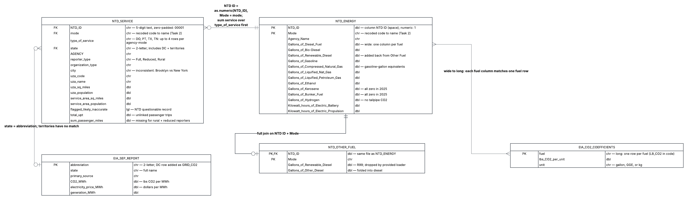
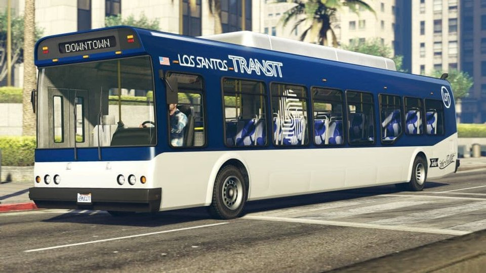

```{r}
#| label: setup
#| include: false

# Shared libraries, a house plot theme, and number formatters used throughout.
library(tidyverse)
library(httr2)
library(rvest)
library(fs)
library(readxl)
library(gt)
library(scales)
library(ggrepel)

# Color system (matches the page's GTA 6 theme), used the same way everywhere:
#   purple gradient = "how much" (darker = more)
#   cobalt blue     = good (cleaner than driving alone, actual transit emissions)
#   burnt orange    = bad (dirtier than driving, missing data, dirtiest grids)
GTA_PURPLE <- "#8E2DE2"
GTA_PURPLE_DARK <- "#4A148C"
GTA_LAVENDER <- "#E1D5F7"
GTA_COBALT <- "#3D5AFE"
GTA_COBALT_LIGHT <- "#C5CAFF"
GTA_ORANGE <- "#F4511E"
GTA_PEACH <- "#FFD3BF"
GTA_GREY <- "#9E9E9E"

# Purple gradient for "how much" bars, shown with a color key
scale_fill_amount <- function(name, ...) {
  scale_fill_gradient(low = GTA_LAVENDER, high = GTA_PURPLE_DARK, name = name, ...)
}

# Good vs. bad relative to one person driving alone, shown with a color key
CAR_COMPARISON_COLORS <- c(
  "Cleaner than driving alone" = GTA_COBALT,
  "Dirtier than driving alone" = GTA_ORANGE
)
vs_car <- function(x, benchmark) {
  factor(
    if_else(x <= benchmark, names(CAR_COMPARISON_COLORS)[1], names(CAR_COMPARISON_COLORS)[2]),
    levels = names(CAR_COMPARISON_COLORS)
  )
}

# Element-wise sum of several equal-length numeric vectors
sum_terms <- function(...) Reduce(`+`, list(...))

# Label each Task 3 visual with the assignment question it answers
q_label <- function(id, question) paste0(id, ": ", question)

theme_gta <- function(base_size = 14) {
  theme_minimal(base_size = base_size) +
    theme(
      plot.title = element_text(face = "bold", color = GTA_PURPLE),
      plot.title.position = "plot",
      plot.caption = element_text(color = "grey40", size = rel(0.7), hjust = 0),
      plot.caption.position = "plot",
      panel.grid.minor = element_blank(),
      legend.position = "top"
    )
}

# Consistent gt styling for every table in the report
gt_gta <- function(tbl) {
  tbl |>
    tab_options(
      heading.background.color = GTA_PURPLE,
      column_labels.font.weight = "bold",
      table.font.size = px(14),
      source_notes.font.size = px(11)
    ) |>
    opt_row_striping()
}

fmt_comma <- label_comma(accuracy = 1)
fmt_2 <- label_number(accuracy = 0.01)
fmt_1 <- label_number(accuracy = 0.1)
fmt_big <- label_number(scale_cut = cut_short_scale(), accuracy = 0.1)
fmt_pct <- label_percent(accuracy = 1)
fmt_x <- function(x) paste0(label_number(accuracy = 0.1)(x), "\u00D7")

# Strip legal names down to the public-facing "doing business as" name
# (very short brands like "the e" keep the legal name for context)
short_name <- function(agency) {
  legal <- str_remove(agency, ",?\\s*dba:.*$") |> str_squish()
  dba <- if_else(str_detect(agency, "dba: "), str_remove(agency, "^.*dba: "), NA) |> str_squish()
  case_when(
    is.na(dba) ~ legal,
    str_length(dba) < 6 ~ paste0(legal, " (", dba, ")"),
    .default = dba
  )
}

LB_PER_METRIC_TON <- 2204.62
```

Hi viewers, this is my second mini project. Before you immediately assume this is all vibe coded slop, this layout you see is just an homage to the upcoming GTA 6 video game's color scheme...where I did ask for assistance on coding the CSS file for mp02 (It looks cool tho, right?)

With that out of the way...
Welcome to the Green Transit Alliance (GTA). While this page's color scheme and layout is an homage to the upcoming GTA 6 video game, our mission here is strictly ENVIRONMENTAL. We want to evaluate the true ecological performance of the USA's public transportation agencies.

If we were to just look at the highest and lowest carbon footprint, this analysis would be over and we'd call the MTA the worst since they generate the most emissions. However it goes way deeper, and that MTA data may actually be a good thing, wanna find out why? The answer will be in the press report!

Beyond that, buses, trains, and ferries all use vastly different amounts of energy and serve extremely different passenger volumes, meaning a sprawling subway system will naturally emit more total carbon than a local small town's bus fleet. To help level the playing field, we'll integreate the 2025 National Transit Database (NTD) fuel and ridership data (funnily enough I applied for an MTA job that has to do with ridership data) with state-level electricity emissions profiles.

By standardizing our evaluation around a core mteric of pounds of CO2 per passneger-mile and grouping agencies by size, we can accurately measure actual efficiency. Based on this Value Index, we are proud to present our 2026 awards, including the Greenest Transit Agency, Most Emissions Avoided, and our inaugural Battery-Bus Pioneer award. There may be some secret awards as well (remember to put funny ones such as the gas guzzler or literally the worst transit agency ever)

## Data Acquisition

### State Electricity Profiles (Task 1a)

```{r}
#| label: eia-sep
get_eia_sep <- function(state, abbr) {
  library(tidyverse)
  library(stringr)
  library(httr2)
  library(rvest)
  library(fs)

  state_formatted <- str_to_lower(state) |> str_replace_all("\\s", "")

  dir_name <- fs::path("data", "mp02")
  file_name <- fs::path(dir_name, state_formatted)

  fs::dir_create(dir_name, recurse = TRUE)

  if (!fs::file_exists(file_name)) {
    BASE_URL <- "https://www.eia.gov"
    RESPONSE <- request(BASE_URL) |>
      req_url_path(
        "electricity",
        "state",
        state_formatted
      ) |>
      req_headers(
        `User-Agent` = "Mozilla/5.0 (Macintosh; Intel Mac OS X 10.15; rv:149.0) Gecko/20100101 Firefox/149.0"
      ) |>
      req_retry(
        max_tries = 4,
      ) |>
      req_perform(file_name)

    resp_check_status(RESPONSE)
  }

  TABLE <- read_html(file_name) |>
    html_element("table") |>
    html_table() |>
    mutate(Item = str_to_lower(Item))

  if ("U.S. rank" %in% colnames(TABLE)) {
    TABLE <- TABLE |> rename(Rank = `U.S. rank`)
  }

  CO2_MWh <- TABLE |> # nolint: object_name_linter.
    filter(Item == "carbon dioxide (lbs/mwh)") |>
    pull(Value) |>
    str_replace_all(",", "") |>
    as.numeric()

  PRIMARY <- TABLE |>
    filter(Item == "primary energy source") |>
    pull(Rank)

  RATE <- TABLE |>
    filter(Item == "average retail price (cents/kwh)") |>
    pull(Value) |>
    as.numeric()

  GENERATION_MWh <- TABLE |> # nolint: object_name_linter.
    filter(Item == "net generation (megawatthours)") |>
    pull(Value) |>
    str_replace_all(",", "") |>
    as.numeric()

  data.frame(
    CO2_MWh = CO2_MWh,
    primary_source = PRIMARY,
    electricity_price_MWh = RATE * 10, # / 100 cents to dollars &
    # * 1000 kWh to MWH
    generation_MWh = GENERATION_MWh,
    state = state,
    abbreviation = abbr
  )
}

EIA_SEP_REPORT <- map2(state.name, state.abb, get_eia_sep) |> list_rbind()

# Washington, DC is home to WMATA (300M+ annual trips) but is not in
# `state.name`. EIA publishes a DC profile in the same format, so we add it to
# a separate grid table used only for the emissions join. The 50-state
# EIA_SEP_REPORT above is kept as-is for the state-level EDA questions.
GRID_CO2 <- bind_rows(
  EIA_SEP_REPORT,
  get_eia_sep("District of Columbia", "DC")
)
```

1a: Loaded all the EIA electricity profiles. 

The data tells us one page per state from the government's energy agency. Basically how 'dirty' each state's electricity is and what it costs. This matters because electric trains and buses are only as clean as the power plants that power them (You are only as strong as your weakest link). DC was also added because the metro is huge.

### NTD Energy Usage (Task 1b)

```{r}
#| label: ntd-energy
load_ntd_energy <- function() {
  library(readxl)
  library(httr2)
  library(tidyverse)
  library(fs)

  # Create 'data/mp02' directory if not already present
  DATA_DIR <- fs::path("data", "mp02")
  fs::dir_create(DATA_DIR, recurse = TRUE)

  NTD_ENERGY_FILE <- fs::path(DATA_DIR, "2025_ntd_energy.xlsx")

  if (!fs::file_exists(NTD_ENERGY_FILE)) {
    library(httr2)

    request("https://www.transit.dot.gov/") |>
      req_url_path(
        "sites",
        "fta.dot.gov",
        "files",
        "2026-09",
        "2025 Energy Consumption_260806.xlsx"
      ) |>
      req_headers(
        `User-Agent` = "Mozilla/5.0 (Macintosh; Intel Mac OS X 10.15; rv:149.0) Gecko/20100101 Firefox/149.0"
      ) |>
      req_perform(NTD_ENERGY_FILE)
  }

  if (file.info(NTD_ENERGY_FILE)$size < 1e4) {
    cat("I was unable to download the NTD Energy File. Please try again.\n")
    stop("Download failed. Please delete the corrupted file by running `unlink('data/mp02/2025_ntd_energy.xlsx')` and try again.") # nolint: line_length_linter.
  }

  to_numeric_fill_0 <- function(x) {
    x <- if_else(x == "-", NA, x)
    replace_na(as.numeric(x), 0)
  }

  read_excel(NTD_ENERGY_FILE) |>
    select(-c(
      `Reporter Type`,
      `Reporting Module`,
      `Gallons of Other Fuel`,
      `Other Fuel Description`
    )) |>
    mutate(across(
      -c(
        `Agency Name`,
        `Mode`,
        `TOS`
      ),
      to_numeric_fill_0
    )) |>
    group_by(`NTD ID`, `Mode`, `Agency Name`) |>
    summarize(across(where(is.numeric), sum),
      .groups = "keep"
    ) |>
    mutate(ENERGY = sum(c_across(c(where(is.numeric))))) |>
    filter(ENERGY > 0) |>
    select(-ENERGY) |>
    ungroup()
}

NTD_ENERGY <- load_ntd_energy()
```


```{r}
#| label: ntd-other-fuel

# The loader above drops the "Other Fuel" columns. In the 2025 file, every
# "Other Fuel" entry is a diesel-type fuel, mostly R99 renewable diesel
# (~10M gallons at TriMet, Community Transit, MBTA, King County, Kitsap,
# NYC DOT's Staten Island Ferry, and BART). Dropping it would treat those
# buses and ferries as zero-emission. We re-read just those columns from the
# same local file and add them back as two new fuel columns.
load_ntd_other_fuel <- function() {
  NTD_ENERGY_FILE <- fs::path("data", "mp02", "2025_ntd_energy.xlsx")

  read_excel(NTD_ENERGY_FILE) |>
    transmute(
      `NTD ID` = as.numeric(`NTD ID`),
      Mode,
      gallons = suppressWarnings(as.numeric(`Gallons of Other Fuel`)),
      is_renewable = str_detect(
        coalesce(`Other Fuel Description`, ""),
        regex("renew|R-?D?\\s?99", ignore_case = TRUE)
      )
    ) |>
    filter(gallons > 0) |>
    group_by(`NTD ID`, Mode) |>
    summarize(
      `Gallons of Renewable Diesel` = sum(gallons[is_renewable]),
      `Gallons of Other Diesel` = sum(gallons[!is_renewable]),
      .groups = "drop"
    )
}

NTD_OTHER_FUEL <- load_ntd_other_fuel()

# full_join so an agency-mode that ran *only* on renewable diesel (and was
# therefore filtered out by the loader) is not lost.
NTD_ENERGY <- NTD_ENERGY |>
  full_join(NTD_OTHER_FUEL, join_by(`NTD ID`, Mode)) |>
  mutate(across(where(is.numeric), \(x) replace_na(x, 0))) |>
  # The only non-renewable "Other Fuel" entry is ordinary diesel filed in the
  # wrong column, so it is folded back into diesel.
  mutate(`Gallons of Diesel Fuel` = `Gallons of Diesel Fuel` + `Gallons of Other Diesel`) |>
  # Bio-Diesel Description is free text in the source; the loader coerces it to 0
  select(-`Bio-Diesel Description`, -`Gallons of Other Diesel`)

other_fuel_total <- sum(NTD_OTHER_FUEL$`Gallons of Renewable Diesel`) +
  sum(NTD_OTHER_FUEL$`Gallons of Other Diesel`)
other_fuel_n_agencies <- n_distinct(NTD_OTHER_FUEL$`NTD ID`)
```

1b: Fuel use

The data tells us how much fuel and electricity each transit agency used.

### NTD Service Provided (Task 1c)

```{r}
#| label: ntd-service
load_ntd_service <- function() {
  library(httr2)
  library(tidyverse)
  library(fs)

  # Create 'data/mp02' directory if not already present
  DATA_DIR <- fs::path("data", "mp02")
  fs::dir_create(DATA_DIR, recurse = TRUE)

  NTD_SERVICE_FILE <- fs::path(DATA_DIR, "2025_ntd_service.csv")

  if (!fs::file_exists(NTD_SERVICE_FILE)) {
    library(httr2)

    request("https://data.transportation.gov/resource/4fir-qbim.csv") |>
      req_url_query(`$query` = paste(
        "SELECT  `_5_digit_ntd_id` AS `NTD_ID`",
        "`max_agency` AS `AGENCY`",
        "`max_reporter_type` AS `reporter_type`",
        "`max_organization_type` AS `organization_type`",
        "`max_city` AS `city`",
        "`max_state` AS `state`",
        "`mode`",
        "`type_of_service`",
        "`max_primary_uza_code` as `uza_code`",
        "`max_primary_uza_name` as `uza_name`",
        "`max_primary_uza_area_sq_miles` as `uza_sq_miles`",
        "`max_primary_uza_population` as `uza_population`",
        "`max_service_area_sq_miles` as `service_area_sq_miles`",
        "`max_service_area_population` as `service_area_population`",
        "`questionable_record` as `flagged_likely_inaccurate`",
        "`sum_unlinked_passenger_trips_upt` as `total_upt`",
        "`sum_passenger_miles` WHERE caseless_one_of(`report_year`, '2025') limit 50000",
        sep = ","
      )) |>
      req_headers(
        `User-Agent` = "Mozilla/5.0 (Macintosh; Intel Mac OS X 10.15; rv:149.0) Gecko/20100101 Firefox/149.0"
      ) |>
      req_perform(NTD_SERVICE_FILE)
  }

  if (file.info(NTD_SERVICE_FILE)$size < 1e4) {
    cat("I was unable to download the NTD Service File. Please try again.\n")
    stop("Download failed. Please delete the corrupted file by running `unlink('data/mp02/2025_ntd_service.xlsx')` and try again.") # nolint: line_length_linter.
  }

  read_csv(NTD_SERVICE_FILE) |>
    mutate(flagged_likely_inaccurate = !is.na(flagged_likely_inaccurate))
}

NTD_SERVICE <- load_ntd_service()
```

1c: Ridership

The data tells us how many trips and miles riders took on each agency

## Data Cleaning and Preparation

### Recoding the `Mode` column (Task 2)

```{r}
#| label: mode-codes
# Distinct codes across both NTD tables
mode_codes <- union(unique(NTD_ENERGY$Mode), unique(NTD_SERVICE$mode)) |> sort()

# Names from the NTD's own mode lookup (data.transportation.gov `mode_name`)
recode_mode <- function(x) {
  recode_values(
    x,
    "AR" ~ "Alaska Railroad",
    "CB" ~ "Commuter Bus",
    "CC" ~ "Cable Car",
    "CR" ~ "Commuter Rail",
    "DR" ~ "Demand Response",
    "FB" ~ "Ferryboat",
    "HR" ~ "Heavy Rail",
    "IP" ~ "Inclined Plane",
    "LR" ~ "Light Rail",
    "MB" ~ "Bus",
    "MG" ~ "Monorail/Automated Guideway",
    "RB" ~ "Bus Rapid Transit",
    "SR" ~ "Streetcar Rail",
    "TB" ~ "Trolleybus",
    "TR" ~ "Aerial Tramway",
    "VP" ~ "Vanpool",
    "YR" ~ "Hybrid Rail",
    default = "Unknown"
  )
}

NTD_ENERGY <- NTD_ENERGY |> mutate(Mode = recode_mode(Mode))
NTD_SERVICE <- NTD_SERVICE |> mutate(mode = recode_mode(mode))

stopifnot(!"Unknown" %in% c(NTD_ENERGY$Mode, NTD_SERVICE$mode))
```

All `r length(mode_codes)` mode codes in the data (`r str_flatten_comma(mode_codes)`) map to a name.

## Initial Exploration (Task 3)

### State electricity profiles

```{r}
#| label: plot-3a1-price
#| fig-width: 9
#| fig-height: 4.5
EIA_SEP_REPORT |>
  slice_max(electricity_price_MWh, n = 5) |>
  mutate(state = fct_reorder(state, electricity_price_MWh)) |>
  ggplot(aes(x = electricity_price_MWh, y = state, fill = electricity_price_MWh)) +
  geom_col(width = 0.7) +
  scale_fill_amount("Price per MWh", labels = label_dollar()) +
  geom_text(aes(label = dollar(electricity_price_MWh, accuracy = 1)),
    hjust = -0.15, size = 4.5
  ) +
  scale_x_continuous(
    labels = label_dollar(), expand = expansion(mult = c(0, 0.15))
  ) +
  labs(
    title = str_wrap(q_label("3a.1", paste0(
      "Which 5 states have the most expensive retail electricity?"
    )), 75),
    subtitle = "Average retail price per MWh (1,000 kWh), five highest states",
    x = NULL, y = NULL,
    caption = "Source: U.S. Energy Information Administration, State Electricity Profiles"
  ) +
  theme_gta() +
  theme(legend.position = "right")
```

```{r}
#| label: table-3a2-dirtiest
EIA_SEP_REPORT |>
  slice_max(CO2_MWh, n = 5) |>
  select(state, primary_source, CO2_MWh, electricity_price_MWh) |>
  gt() |>
  tab_header(
    title = q_label("3a.2", "Which 5 states have the \u2018dirtiest\u2019 electricity mix?"),
    subtitle = "Pounds of CO\u2082 emitted per MWh generated"
  ) |>
  cols_label(
    state = "State",
    primary_source = "Primary source",
    CO2_MWh = "lbs CO\u2082 / MWh",
    electricity_price_MWh = "Price / MWh"
  ) |>
  fmt_number(CO2_MWh, decimals = 0) |>
  fmt_currency(electricity_price_MWh, decimals = 0) |>
  data_color(CO2_MWh, palette = c(GTA_PEACH, GTA_ORANGE)) |>
  tab_source_note("Color key: darker orange = more CO\u2082 per MWh (dirtier electricity).") |>
  tab_source_note("Source: U.S. Energy Information Administration, State Electricity Profiles") |>
  gt_gta()
```

```{r}
#| label: eda-3a-inline
# 3a.3: generation-weighted average, so Texas counts more than Vermont
us_avg_co2 <- with(EIA_SEP_REPORT, sum(CO2_MWh * generation_MWh) / sum(generation_MWh))
us_simple_avg_co2 <- mean(EIA_SEP_REPORT$CO2_MWh)

# 3a.5: Texas vs New York
tx_co2 <- EIA_SEP_REPORT |>
  filter(abbreviation == "TX") |>
  pull(CO2_MWh)
ny_co2 <- EIA_SEP_REPORT |>
  filter(abbreviation == "NY") |>
  pull(CO2_MWh)
tx_ny_ratio <- tx_co2 / ny_co2
```

3a.3 Average US Electricity Emissions

To establish a national baseline, we calculated the average emissions across the United States. By weighting each state's emissions (pounds of CO₂ per MWh) by its total electricity generation, we determined that the US power grid emits an average of `r fmt_comma(us_avg_co2)` pounds of CO₂ per MWh of electricity produced.

```{r}
#| label: table-3a4-rare-sources
# 3a.4: "rarest" = primary source for the fewest states. Slicing the three
# smallest counts keeps any ties at the cutoff (here none: the third-rarest
# count is 4 and the next source has 5 states).
rarest_sources <- EIA_SEP_REPORT |>
  count(primary_source, name = "n_states") |>
  slice_min(n_states, n = 3)

rare_source_tbl <- EIA_SEP_REPORT |>
  inner_join(rarest_sources, join_by(primary_source)) |>
  group_by(primary_source) |>
  mutate(
    # generation-weighted, so a big producer counts more than a small one
    avg_price = weighted.mean(electricity_price_MWh, generation_MWh),
    group_label = paste0(
      primary_source, ": ", n_states, if_else(n_states == 1, " state", " states"),
      ", average ", dollar(avg_price, accuracy = 1), " / MWh"
    )
  ) |>
  ungroup() |>
  arrange(n_states, primary_source, desc(electricity_price_MWh))

rare_source_prices <- rare_source_tbl |>
  distinct(primary_source, n_states, avg_price)

rare_source_tbl |>
  select(group_label, state, electricity_price_MWh, CO2_MWh) |>
  gt(groupname_col = "group_label") |>
  tab_header(
    title = q_label("3a.4", paste0(
      "What are the three rarest primary energy sources in the US? What is ",
      "the associated cost of electricity associated with each source and in ",
      "what states are they used?"
    )),
    subtitle = paste0(
      "States grouped by their largest source of electricity; group averages ",
      "weighted by generation"
    )
  ) |>
  cols_label(
    state = "State",
    electricity_price_MWh = "Price / MWh",
    CO2_MWh = "lbs CO\u2082 / MWh"
  ) |>
  fmt_currency(electricity_price_MWh, decimals = 0) |>
  fmt_number(CO2_MWh, decimals = 0) |>
  data_color(electricity_price_MWh, palette = c(GTA_LAVENDER, GTA_PURPLE_DARK)) |>
  tab_source_note("Color key: darker purple = higher price.") |>
  tab_style(cell_text(weight = "bold"), cells_row_groups()) |>
  tab_source_note("Source: U.S. Energy Information Administration, State Electricity Profiles") |>
  gt_gta()
```

3a.4 Rarest Primary Energy Sources

Three rarest are petroleum, hydroelectric, and wind. Petroleum is primary source for just one state (Hawaii) at an average price of $380/MWh, while hydroelectric and wind are the primary sources for four states each, averaging 105/MWh and 100/MWh, respectively


3a.5 Texas vs. New York Energy Mix

Public reputation regarding state energy policies is strongly reflected in the data. While Texas is known for its heavy reliance on fossil fuels and New York for its clean energy initiatives, the numbers reveal exactly how wide that gap is. Texas electricity produces a significantly higher carbon footprint per MWh, making New York's overall energy mix `r fmt_2(tx_ny_ratio)` times cleaner than that of Texas.

### Transit energy usage

```{r}
#| label: table-3b1-top-fuel
# Liquid and gaseous fuels reported in gallons; electricity (kWh) and
# hydrogen are excluded because they are not measured in gallons.
fuel_gallon_cols <- c(
  "Diesel" = "Gallons of Diesel Fuel",
  "Bio-diesel" = "Gallons of Bio-Diesel",
  "Renewable diesel" = "Gallons of Renewable Diesel",
  "Gasoline" = "Gallons of Gasoline",
  "CNG" = "Gallons of Compressed Natural Gas",
  "LPG" = "Gallons of Liquified Petroleum Gas"
)

agency_names <- NTD_SERVICE |>
  distinct(NTD_ID, AGENCY) |>
  mutate(`NTD ID` = as.numeric(NTD_ID), agency = short_name(AGENCY)) |>
  select(`NTD ID`, agency)

top_fuel_users <- NTD_ENERGY |>
  group_by(`NTD ID`) |>
  summarize(across(all_of(unname(fuel_gallon_cols)), sum)) |>
  rename(all_of(fuel_gallon_cols)) |>
  mutate(Total = rowSums(pick(-`NTD ID`))) |>
  slice_max(Total, n = 5) |>
  left_join(agency_names, join_by(`NTD ID`)) |>
  select(agency, Total, Diesel:LPG) |>
  # drop fuel columns no top-5 agency uses
  select(where(\(x) !is.numeric(x) || sum(x) > 0))

top_fuel_users |>
  gt() |>
  tab_header(
    title = q_label("3b.1", paste0(
      "Which five transit agencies used the most gallons of fuel (all ",
      "sources) and how did it breakdown by type?"
    )),
    subtitle = "Millions of gallons, all liquid and gaseous fuels"
  ) |>
  cols_label(agency = "Agency") |>
  fmt_number(-agency, scale_by = 1e-6, decimals = 1) |>
  sub_zero(zero_text = "\u2014") |>
  data_color(Total, palette = c(GTA_LAVENDER, GTA_PURPLE_DARK)) |>
  tab_source_note("Color key: darker purple = more total fuel.") |>
  tab_style(cell_text(weight = "bold"), cells_body(columns = Total)) |>
  tab_source_note(paste0(
    "Source: FTA National Transit Database, 2025 Energy Consumption. CNG in ",
    "gasoline-gallon equivalents."
  )) |>
  gt_gta()
```

```{r}
#| label: plot-3b2-fuel-mix
#| fig-width: 10
#| fig-height: 5.5

# Gallons and kWh are not comparable, so convert everything to energy
# (million Btu). Heat contents are EIA's (lbs CO2 per unit / lbs CO2 per
# MMBtu) where EIA lists the fuel, otherwise BTS National Transportation
# Statistics Table 4-16 notes.
MMBTU_PER_UNIT <- c(
  "Gallons of Diesel Fuel" = 22.45 / 163.45,
  "Gallons of Bio-Diesel" = 0.127595,
  "Gallons of Renewable Diesel" = 22.45 / 163.45,
  "Gallons of Gasoline" = 18.73 / 155.77,
  "Gallons of Compressed Natural Gas" = 18.73 / 155.77, # gasoline-gallon equivalents
  "Gallons of Liquified Nat Gas" = 0.0848,
  "Gallons of Liquified Petroleum Gas" = 12.68 / 138.63,
  "Gallons of Ethanol" = 0.0846,
  "Gallons of Kerosene" = 21.78 / 161.35,
  "Gallons of Bunker Fuel" = 24.78 / 165.55,
  "Gallons of Hydrogen" = 0.1344, # reported per kg; HHV of 1 kg H2
  "Kilowatt hours of Electric Battery" = 0.003412,
  "Kilowatt hours of Electric Propulsion" = 0.003412
)

fuel_energy <- NTD_ENERGY |>
  summarize(across(all_of(names(MMBTU_PER_UNIT)), sum)) |>
  pivot_longer(everything(), names_to = "column", values_to = "units") |>
  mutate(
    mmbtu = units * MMBTU_PER_UNIT[column],
    fuel = column |>
      str_remove("^(Gallons of|Kilowatt hours of) ") |>
      str_replace("Liquified Nat Gas", "Liquefied natural gas") |>
      str_replace("Liquified Petroleum Gas", "Propane (LPG)") |>
      str_replace("Electric Propulsion", "Electric (overhead wire / third rail)") |>
      str_replace("Electric Battery", "Electric (battery)") |>
      str_replace("Diesel Fuel", "Diesel")
  )

unused_fuels <- fuel_energy |>
  filter(units == 0) |>
  pull(fuel)
least_used_fuel <- fuel_energy |>
  filter(units > 0) |>
  slice_min(mmbtu, n = 1)

fuel_energy |>
  filter(units > 0) |>
  mutate(
    fuel = fct_reorder(fuel, mmbtu),
    is_electric = str_detect(fuel, "Electric")
  ) |>
  ggplot(aes(x = mmbtu, y = fuel, fill = is_electric)) +
  geom_col(width = 0.7) +
  geom_text(aes(label = fmt_big(mmbtu)), hjust = -0.1, size = 4) +
  scale_fill_manual(
    values = c(`TRUE` = GTA_PURPLE, `FALSE` = GTA_GREY),
    labels = c(`TRUE` = "Electricity", `FALSE` = "Combustion fuel"), name = NULL
  ) +
  scale_x_continuous(
    labels = label_number(scale_cut = cut_short_scale()),
    expand = expansion(mult = c(0, 0.12))
  ) +
  labs(
    title = str_wrap(q_label("3b.2", paste0(
      "Across all US public transit, visualize the amounts of each type of ",
      "fuel used"
    )), 75),
    subtitle = "Total energy used in 2025, million Btu",
    x = "Million Btu", y = NULL,
    caption = paste0(
      "Sources: FTA National Transit Database 2025 Energy Consumption; heat ",
      "contents from EIA and BTS.\nBunker fuel and kerosene were not used by ",
      "any agency."
    )
  ) +
  theme_gta()
```

3b.3 Kerosene and bunker fuel were completely unused by any public transit agency. Out of all the fuels that were actually consumed, the least commonly used fuel was "Other Diesel" (Wonder why they classify it as Other), with a total of just 2,393 gallons used.

### Transit service

```{r}
#| label: plot-3c1-top-upt
#| fig-width: 10
#| fig-height: 5
# 3c.1: a "transit service" = one agency's mode (e.g., NYC subway vs. NYC
# buses), summed across directly operated + purchased service.
top_upt_services <- NTD_SERVICE |>
  group_by(AGENCY, mode) |>
  summarize(upt = sum(total_upt, na.rm = TRUE), .groups = "drop") |>
  slice_max(upt, n = 5) |>
  mutate(service = fct_reorder(paste0(short_name(AGENCY), " \u2014 ", mode), upt))

top_upt_services |>
  ggplot(aes(x = upt, y = service, fill = upt)) +
  geom_col(width = 0.7) +
  scale_fill_amount("Annual trips", labels = label_number(scale_cut = cut_short_scale())) +
  geom_text(aes(label = fmt_big(upt)), hjust = -0.15, size = 4.5) +
  scale_x_continuous(
    labels = label_number(scale_cut = cut_short_scale()),
    expand = expansion(mult = c(0, 0.2))
  ) +
  labs(
    title = str_wrap(q_label("3c.1", paste0(
      "Which five transit services have the most UPT annually?"
    )), 75),
    subtitle = "Annual unlinked passenger trips; a service is one agency's mode",
    x = "Unlinked passenger trips", y = NULL,
    caption = "Source: FTA National Transit Database, 2025 Service by Agency"
  ) +
  theme_gta() +
  theme(legend.position = "right")
```

3c.1 
The busiest transit service is MTA New York City Transit (Heavy Rail), which recorded 2.3 billion trips.

```{r}
#| label: eda-3c-inline
# 3c.2: passenger-miles / trips, across all MTA NYC Transit modes
mta_nyct <- NTD_SERVICE |>
  filter(AGENCY == "MTA New York City Transit") |>
  summarize(upt = sum(total_upt, na.rm = TRUE), pmt = sum(sum_passenger_miles, na.rm = TRUE))
mta_trip_miles <- mta_nyct$pmt / mta_nyct$upt

# 3c.5: which states are missing?
missing_states <- setdiff(state.abb, NTD_SERVICE$state)
extra_jurisdictions <- setdiff(unique(NTD_SERVICE$state), state.abb) |> sort()

# 3c.3: per the hint, the `city` column is inconsistent: MTA NYC Transit is
# listed under "Brooklyn" while Metro-North, LIRR, and MTA Bus are under
# "New York". We match any of the five boroughs instead of one city name.
NYC_CITIES <- c("New York", "Brooklyn", "Bronx", "Queens", "Staten Island")
nyc_trip_lengths <- NTD_SERVICE |>
  filter(state == "NY", city %in% NYC_CITIES) |>
  group_by(AGENCY, mode) |>
  summarize(
    upt = sum(total_upt, na.rm = TRUE),
    pmt = sum(sum_passenger_miles, na.rm = TRUE),
    .groups = "drop"
  ) |>
  filter(upt > 0, pmt > 0) |>
  mutate(agency = short_name(AGENCY), trip_miles = pmt / upt) |>
  arrange(desc(trip_miles))
nyc_longest <- slice(nyc_trip_lengths, 1)
nyc_runner_up <- slice(nyc_trip_lengths, 2)
nyc_cities_found <- NTD_SERVICE |>
  filter(state == "NY", city %in% NYC_CITIES) |>
  distinct(city) |>
  pull(city)
```

3c.2 
The average trip length on MTA NYC Transit is 3.2 miles per trip.

3c.3
The transit service with the longest average trip length in New York City is the MTA Metro-North Railroad (Commuter Rail) at 24.3 miles per trip. The runner-up is the MTA Long Island Rail Road (Commuter Rail) at 23.1 miles per trip

```{r}
#| label: plot-3c4-fewest-pmt
#| fig-width: 10
#| fig-height: 5
# 3c.4: Rural and reduced reporters do not report passenger-miles at all
# (100% missing vs. 0.5% for full reporters), so a state's total can be low
# just because its trips have no mileage on record. We show that share too.
state_pmt <- NTD_SERVICE |>
  filter(state %in% state.abb) |>
  group_by(state) |>
  summarize(
    pmt = sum(sum_passenger_miles, na.rm = TRUE),
    upt = sum(total_upt, na.rm = TRUE),
    upt_no_pmt = sum(total_upt[is.na(sum_passenger_miles) | sum_passenger_miles == 0], na.rm = TRUE),
    .groups = "drop"
  ) |>
  mutate(
    share_missing = upt_no_pmt / upt,
    state_name = state.name[match(state, state.abb)]
  )

fewest_pmt <- state_pmt |> slice_min(pmt, n = 5, with_ties = FALSE)
zero_pmt_states <- state_pmt |>
  filter(pmt == 0) |>
  pull(state_name)
pmt_missing_by_reporter <- NTD_SERVICE |>
  group_by(reporter_type) |>
  summarize(share_missing = mean(is.na(sum_passenger_miles) | sum_passenger_miles == 0))

fewest_pmt |>
  mutate(
    state_name = fct_reorder(state_name, pmt, .desc = TRUE),
    label = paste0(fmt_1(pmt / 1e6), "M  (", fmt_pct(share_missing), " of trips unreported)")
  ) |>
  ggplot(aes(x = pmt / 1e6, y = state_name, fill = share_missing)) +
  geom_col(width = 0.7) +
  geom_text(aes(label = label), hjust = -0.03, size = 4) +
  scale_fill_gradient(
    low = GTA_PEACH, high = GTA_ORANGE, limits = c(0, 1),
    labels = label_percent(), name = "Trips with no\nmileage reported"
  ) +
  scale_x_continuous(expand = expansion(mult = c(0, 0.75))) +
  labs(
    title = str_wrap(q_label("3c.4", paste0(
      "Which five states has the fewest total miles travelled by public ",
      "transit?"
    )), 75),
    subtitle = paste0(
      "Reported passenger-miles (millions). Rural and reduced NTD reporters ",
      "do not report mileage."
    ),
    x = "Passenger-miles (millions)", y = NULL,
    caption = "Source: FTA National Transit Database, 2025 Service by Agency"
  ) +
  theme_gta() +
  theme(legend.position = "right")
```

3c.5 
All 50 states are represented in the dataset. The data also includes extra jurisdictions, specifically Washington, D.C. and U.S. territories (AS, GU, MP, PR, and VI).


## Data Integration: Calculating Emissions (Task 5)

### Relationship Diagram (Extra Credit #01)

{.lightbox fig-alt="Entity-relationship diagram of the five tables used in this project (NTD service, NTD energy, NTD other fuel, EIA state electricity profiles, EIA CO2 coefficients), their columns and types, and how they join"}

I learned how to use LucidChart from CIS 9340!

```{r}
#| label: emission-factors
# Pounds of CO2 per unit, from EIA "Carbon Dioxide Emissions Coefficients"
# (released Sept 2024). Tailpipe accounting: bio-diesel blends (mostly B5-B20)
# and renewable diesel are counted at the diesel rate, i.e., we count all
# carbon that leaves the tailpipe. A sensitivity check further down gives
# renewable diesel a biogenic (zero) rate instead.
LB_CO2 <- c(
  diesel = 22.45, # Diesel and home heating fuel (distillate)
  gasoline = 18.73, # Finished motor gasoline (E10, as sold at the pump)
  lpg = 12.68, # Propane
  kerosene = 21.78,
  residual = 24.78, # Residual fuel oil (closest match to bunker fuel)
  # NTD reports CNG in gasoline-gallon equivalents (GGE): reported CNG bus
  # fuel economy (~2.5-4 mpg) is only plausible on an equivalent basis.
  # lbs per GGE = natural gas lbs/MMBtu x gasoline MMBtu/gallon.
  cng = 116.65 * (18.73 / 155.77),
  lng = 116.65 * 0.0848, # natural gas lbs/MMBtu x LNG MMBtu/gallon (BTS)
  ethanol = 18.73, # negligible volume; counted as finished gasoline
  hydrogen = 0 # no tailpipe CO2
)

tibble(
  Fuel = c(
    "Diesel, bio-diesel blends, renewable diesel", "Gasoline (E10)", "Propane (LPG)",
    "Compressed natural gas", "Liquefied natural gas", "Kerosene", "Bunker fuel",
    "Hydrogen", "Electricity"
  ),
  Factor = c(
    LB_CO2[c("diesel", "gasoline", "lpg", "cng", "lng", "kerosene", "residual", "hydrogen")],
    NA
  ),
  Unit = c(
    "gallon", "gallon", "gallon", "gasoline-gallon equivalent", "gallon",
    "gallon", "gallon", "kg", "MWh, state-specific"
  )
) |>
  gt() |>
  tab_header(title = "Emission factors used", subtitle = "Pounds of CO\u2082 per unit of energy") |>
  fmt_number(Factor, decimals = 2) |>
  sub_missing(Factor, missing_text = "EIA state profile (e.g., WA 249, WV 1,912)") |>
  tab_source_note(paste0(
    "Sources: EIA Carbon Dioxide Emissions Coefficients (2024); EIA State ",
    "Electricity Profiles; BTS National Transportation Statistics Table ",
    "4-16 (LNG heat content)."
  )) |>
  gt_gta()
```

```{r}
#| label: emissions
# Collapse service to Agency + Mode (it is reported by type of service, and
# energy is already summed over type of service by the loader).
SERVICE_BY_MODE <- NTD_SERVICE |>
  mutate(`NTD ID` = as.numeric(NTD_ID)) |>
  group_by(`NTD ID`, mode) |>
  summarize(
    agency = short_name(first(AGENCY)),
    state = first(state),
    uza_name = first(uza_name),
    flagged = any(flagged_likely_inaccurate),
    upt = sum(total_upt, na.rm = TRUE),
    pmt = sum(sum_passenger_miles, na.rm = TRUE),
    .groups = "drop"
  )

# Every energy row has a service row (checked), so inner joins only drop
# agencies outside the 50 states + DC, which have no EIA grid profile.
EMISSIONS <- NTD_ENERGY |>
  inner_join(SERVICE_BY_MODE, join_by(`NTD ID`, Mode == mode),
    relationship = "one-to-one"
  ) |>
  inner_join(GRID_CO2 |> select(abbreviation, CO2_MWh),
    join_by(state == abbreviation),
    relationship = "many-to-one"
  ) |>
  mutate(
    kwh = `Kilowatt hours of Electric Battery` + `Kilowatt hours of Electric Propulsion`,
    co2_electric = kwh / 1000 * CO2_MWh,
    co2_renewable = `Gallons of Renewable Diesel` * LB_CO2["diesel"],
    co2_combustion = sum_terms(
      (`Gallons of Diesel Fuel` + `Gallons of Bio-Diesel`) * LB_CO2["diesel"],
      `Gallons of Gasoline` * LB_CO2["gasoline"],
      `Gallons of Liquified Petroleum Gas` * LB_CO2["lpg"],
      `Gallons of Compressed Natural Gas` * LB_CO2["cng"],
      `Gallons of Liquified Nat Gas` * LB_CO2["lng"],
      `Gallons of Kerosene` * LB_CO2["kerosene"],
      `Gallons of Bunker Fuel` * LB_CO2["residual"],
      `Gallons of Ethanol` * LB_CO2["ethanol"],
      `Gallons of Hydrogen` * LB_CO2["hydrogen"],
      co2_renewable
    ),
    co2_total = co2_combustion + co2_electric
  )

n_dropped_rows <- nrow(NTD_ENERGY) - nrow(EMISSIONS)
dropped_jurisdictions <- NTD_ENERGY |>
  anti_join(EMISSIONS, join_by(`NTD ID`, Mode)) |>
  left_join(distinct(SERVICE_BY_MODE, `NTD ID`, state), join_by(`NTD ID`)) |>
  distinct(state) |>
  pull(state)
total_transit_co2_tons <- sum(EMISSIONS$co2_total) / LB_PER_METRIC_TON
```

### What the national numbers say: emissions by mode

```{r}
#| label: car-baseline
# Counterfactual: every passenger-mile driven alone in a gasoline car.
# CAFE MY2026 fleetwide standard is ~49 mpg (NHTSA, 2022 final rule). That
# is a lab-test compliance figure; EPA's real-world estimate for new MY2024
# vehicles is 27.2 mpg (Automotive Trends Report), shown as a sensitivity.
CAFE_MPG <- 49
REAL_WORLD_MPG <- 27.2
car_lb_per_mile <- LB_CO2["gasoline"] / CAFE_MPG
car_real_lb_per_mile <- LB_CO2["gasoline"] / REAL_WORLD_MPG
```

```{r}
#| label: plot-mode
#| fig-width: 10
#| fig-height: 6.5
MODE_SUMMARY <- EMISSIONS |>
  filter(pmt > 0, !flagged) |>
  group_by(Mode) |>
  summarize(
    agencies = n(), co2 = sum(co2_total), pmt = sum(pmt), upt = sum(upt),
    .groups = "drop"
  ) |>
  mutate(lb_per_pmt = co2 / pmt)

national_lb_per_pmt <- sum(MODE_SUMMARY$co2) / sum(MODE_SUMMARY$pmt)
vanpool_lb <- MODE_SUMMARY |>
  filter(Mode == "Vanpool") |>
  pull(lb_per_pmt)
heavy_rail_lb <- MODE_SUMMARY |>
  filter(Mode == "Heavy Rail") |>
  pull(lb_per_pmt)
bus_lb <- MODE_SUMMARY |>
  filter(Mode == "Bus") |>
  pull(lb_per_pmt)
ferry_lb <- MODE_SUMMARY |>
  filter(Mode == "Ferryboat") |>
  pull(lb_per_pmt)
dr_lb <- MODE_SUMMARY |>
  filter(Mode == "Demand Response") |>
  pull(lb_per_pmt)

mode_plot_data <- MODE_SUMMARY |>
  filter(agencies >= 3) |> # single-agency modes (e.g., one cable car) are not a "mode average"
  mutate(Mode = fct_reorder(Mode, lb_per_pmt))
label_y <- nrow(mode_plot_data) + 0.9

mode_plot_data |>
  ggplot(aes(x = lb_per_pmt, y = Mode)) +
  geom_col(aes(fill = vs_car(lb_per_pmt, car_lb_per_mile)), width = 0.7) +
  geom_vline(xintercept = car_lb_per_mile, linetype = "dashed") +
  geom_vline(xintercept = car_real_lb_per_mile, linetype = "dotted") +
  annotate("text",
    x = car_lb_per_mile, y = label_y, hjust = -0.03, size = 3.6,
    label = paste0("Solo driver, CAFE car (", CAFE_MPG, " mpg)")
  ) +
  annotate("text",
    x = car_real_lb_per_mile, y = label_y + 0.6, hjust = -0.03, size = 3.6,
    label = paste0("Solo driver, real-world new car (", REAL_WORLD_MPG, " mpg)")
  ) +
  scale_y_discrete(expand = expansion(add = c(0.6, 1.9))) +
  scale_fill_manual(values = CAR_COMPARISON_COLORS, name = NULL) +
  scale_x_continuous(expand = expansion(mult = c(0, 0.05))) +
  labs(
    title = "CO2 per passenger-mile by transit mode, 2025",
    subtitle = "National totals, compared with one person driving a CAFE-standard car",
    x = "Pounds of CO2 per passenger-mile", y = NULL,
    caption = paste0(
      "Sources: FTA National Transit Database (2025 Energy Consumption, ",
      "Service by Agency); EIA State Electricity Profiles and CO2 ",
      "coefficients;\nNHTSA CAFE standards (MY2026); EPA Automotive Trends ",
      "Report (MY2024 real-world fuel economy). Modes reported by fewer than ",
      "3 agencies omitted."
    )
  ) +
  theme_gta()
```

**Emissions by Transit Mode: The National Picture**

Before getting into the specific awards, we should look at how different transit modes are actually performing nationally. In 2025, US public transit generated about `r fmt_big(total_transit_co2_tons)` metric tons of CO2 (That's around 1.5 million adult African elephants, damn). Just a quick heads up that this excludes `r n_dropped_rows` transit records from `r str_flatten_comma(dropped_jurisdictions)` since the EIA doesn't have grid profiles for them.

But to be honest, judging transit just by total carbon output completely misses the point (as bad as the elephant example sounds). The whole goal of public transit is moving people efficiently. When we normalize this by ridership, the national average carbon footprint for public transit is `r fmt_2(national_lb_per_pmt)` lbs of CO2 per passenger-mile. 

For some context, a solo driver in the real world produces about `r fmt_2(car_real_lb_per_mile)` lbs of CO2 per mile. So yeah, taking transit is definitely a win compared to driving an average car. That said, transit as a whole still lags a bit behind the theoretical efficiency of a brand new CAFE standard car at `r fmt_2(car_lb_per_mile)` lbs of CO2 per mile. But unfortunately, nobody actually drives in perfect lab conditions.

When we break the data down by specific modes, a pretty clear hierarchy emerges:

* **The Most Efficient:** Heavy Rail (subways) and Vanpools (a larger carpool like a van or SUV; discovered this term for the first time) are basically carrying the team, sitting at `r fmt_2(heavy_rail_lb)` and `r fmt_2(vanpool_lb)` lbs of CO2 per passenger-mile respectively. Even though they are on complete opposite ends of the infrastructure spectrum, both modes maximize their passenger density relative to the energy they consume which is very economically appreciated
* **The Middle Ground:** Traditional bus systems average `r fmt_2(bus_lb)` lbs per passenger-mile, which puts them slightly above a real-world solo driver. This may feel bad, but it really just reflects how driving heavy diesel vehicles on routes that have low ridership during off-peak hours will reflect.
* **The Least Efficient:** Demand Response (paratransit) and Ferries are the most carbon intensive modes. They generate `r fmt_2(dr_lb)` and `r fmt_2(ferry_lb)` lbs of CO2 per passenger-mile respectively. We can give Demand Response a pass since it is a vital accessibility service that naturally operates with low passenger density and lives are literally on the line most of the time. Ferries on the other hand are just burning ungodly amounts of energy to push heavy boats across the water (but hey ferries are a vibe sometimes).


::: {layout-ncol=3}
{fig-alt="Elevated subway train from Grand Theft Auto IV"}

{fig-alt="Los Santos Transit bus from Grand Theft Auto V"}

{fig-alt="Ambulance from Grand Theft Auto: Vice City"}
:::

## Normalizing to Transit Usage (Task 6)

```{r}
#| label: agency-level
FIXED_ROUTE_MODES <- c(
  "Bus", "Bus Rapid Transit", "Commuter Bus", "Trolleybus", "Light Rail",
  "Heavy Rail", "Commuter Rail", "Streetcar Rail", "Hybrid Rail",
  "Monorail/Automated Guideway", "Ferryboat", "Cable Car", "Inclined Plane",
  "Aerial Tramway", "Alaska Railroad"
)
MIN_UPT <- 100000

# Usage is summed only over modes that also report energy, so numerator and
# denominator always describe the same service. Agency-modes the NTD flags
# as a "questionable record" are dropped from both sides. Dropping the whole
# agency instead would remove, e.g., MTA NYC Transit over one flagged mode.
n_flagged_modes <- sum(EMISSIONS$flagged)
flagged_upt_share <- sum(EMISSIONS$upt[EMISSIONS$flagged]) / sum(EMISSIONS$upt)

AGENCY <- EMISSIONS |>
  filter(pmt > 0, upt > 0, !flagged) |>
  group_by(`NTD ID`) |>
  summarize(
    agency = first(agency),
    state = first(state),
    uza_name = first(uza_name),
    fixed_route = any(Mode %in% FIXED_ROUTE_MODES),
    modes = str_flatten_comma(sort(unique(Mode))),
    co2 = sum(co2_total),
    co2_renewable = sum(co2_renewable),
    co2_electric = sum(co2_electric),
    upt = sum(upt),
    pmt = sum(pmt),
    .groups = "drop"
  ) |>
  mutate(
    lb_per_pmt = co2 / pmt,
    lb_per_upt = co2 / upt,
    # biogenic sensitivity: renewable diesel counted as zero
    lb_per_pmt_biogenic = (co2 - co2_renewable) / pmt,
    car_co2 = pmt * car_lb_per_mile,
    avoided_tons = (car_co2 - co2) / LB_PER_METRIC_TON,
    times_car = lb_per_pmt / car_lb_per_mile,
    size = cut(upt,
      breaks = c(0, 1e6, 2e7, Inf), right = FALSE,
      labels = c("Small", "Medium", "Large")
    )
  )

# Award eligibility: operates fixed-route service (excludes vanpool-only and
# dial-a-ride-only programs) and has >= 100K annual trips.
ELIGIBLE <- AGENCY |> filter(fixed_route, upt >= MIN_UPT)

eligibility_counts <- tibble(
  step = c("Agencies with energy + service data", "Operate fixed-route service", "At least 100K annual trips"),
  n = c(nrow(AGENCY), sum(AGENCY$fixed_route), nrow(ELIGIBLE))
)
size_counts <- ELIGIBLE |> count(size)
size_medians <- ELIGIBLE |>
  group_by(size) |>
  summarize(median_lb_pmt = median(lb_per_pmt), median_lb_upt = median(lb_per_upt))
share_worse_cafe <- mean(ELIGIBLE$lb_per_pmt > car_lb_per_mile)
share_worse_real <- mean(ELIGIBLE$lb_per_pmt > car_real_lb_per_mile)
share_pmt_beating_cafe <- with(ELIGIBLE, sum(pmt[lb_per_pmt < car_lb_per_mile]) / sum(pmt))
share_pmt_beating_real <- with(ELIGIBLE, sum(pmt[lb_per_pmt < car_real_lb_per_mile]) / sum(pmt))
```

```{r}
#| label: table-efficiency
# Most efficient agencies on both bases, by size class
efficiency_tbl <- bind_rows(
  ELIGIBLE |> group_by(size) |> slice_min(lb_per_pmt, n = 3) |> mutate(basis = "Per passenger-mile"),
  ELIGIBLE |> group_by(size) |> slice_min(lb_per_upt, n = 3) |> mutate(basis = "Per trip")
) |>
  ungroup() |>
  select(basis, size, agency, state, modes, lb_per_pmt, lb_per_upt)

efficiency_tbl |>
  gt(groupname_col = "basis", rowname_col = "agency") |>
  tab_header(
    title = "Most carbon-efficient transit agencies, 2025",
    subtitle = "Top 3 in each size class, ranked per passenger-mile and per trip"
  ) |>
  cols_label(
    size = "Size", state = "State", modes = "Modes",
    lb_per_pmt = "lbs CO\u2082 / passenger-mile", lb_per_upt = "lbs CO\u2082 / trip"
  ) |>
  fmt_number(c(lb_per_pmt, lb_per_upt), decimals = 2) |>
  data_color(c(lb_per_pmt, lb_per_upt), palette = c(GTA_COBALT, GTA_COBALT_LIGHT, "white")) |>
  tab_source_note("Color key: darker blue = lower emissions (better).") |>
  tab_source_note(paste0(
    "Size by annual unlinked trips: Small < 1M, Medium 1M\u201320M, Large \u2265 20M. ",
    "Eligible: fixed-route service, \u2265 100K trips; NTD questionable records excluded."
  )) |>
  gt_gta()
```

Methodology: Normalizing to Transit Usage

To evaluate environmental impact fairly, we normalized raw emissions against transit usage. We chose pounds of CO2 per passenger-mile as our primary metric rather than emissions per trip to be 'fairer'. As the data shows, evaluating by trip heavily favors short-distance urban services like streetcars, while passenger-miles better capture the true distance-based environmental benefit of long-distance commuter buses compared to driving. We also restricted eligibility to fixed-route services. While demand-response systems are essential for community accessibility, their inherently low passenger density skews direct efficiency comparisons.

Because transit systems operate on vastly different scales (so we don't compare the MTA and the Skyline from Honolulu), we grouped eligible agencies into three size classes based on annual trips: `r size_counts$n[size_counts$size == "Small"]` Small (under 1M), `r size_counts$n[size_counts$size == "Medium"]` Medium (1M-20M), and `r size_counts$n[size_counts$size == "Large"]` Large (over 20M). For quality control, we had to drop `r n_flagged_modes` agency records as they were flagged as questionable by the NTD, which accounted for `r fmt_pct(flagged_upt_share)` of total trips. Ultimately, out of `r eligibility_counts$n[1]` agencies with energy data, `r eligibility_counts$n[2]` operated fixed routes, leaving a final eligible pool of `r eligibility_counts$n[3]` agencies that met our 100K annual trip minimum.

Compared to a theoretical CAFE standard car, `r fmt_pct(share_worse_cafe)` of transit agencies are dirtier than driving solo, and `r fmt_pct(share_worse_real)` fall short of a real-world solo driver. However, because the absolute cleanest agencies (like major city subways) carry the vast majority of commuters, `r fmt_pct(share_pmt_beating_cafe)` of all transit passenger-miles are ridden on systems cleaner than a CAFE standard car, and `r fmt_pct(share_pmt_beating_real)` beat a real world car. Most transit agencies struggle with efficiency (for example, how common buses drive an empty bus at like 3am. It's nice to have the security of knowing they're always running for someone out there), but most transit riders use highly efficient systems.

## Award Winners (Task 7)

```{r}
#| label: awards
# Award 1: Greenest Agency (lowest CO2 per passenger-mile), by size
greenest <- ELIGIBLE |>
  group_by(size) |>
  slice_min(lb_per_pmt, n = 1, with_ties = FALSE) |>
  ungroup() |>
  left_join(size_medians, join_by(size)) |>
  mutate(times_better_than_median = median_lb_pmt / lb_per_pmt)

# Award 2: Most Emissions Avoided (vs. every passenger-mile driven alone in a
# CAFE-standard car), by size
most_avoided <- ELIGIBLE |>
  group_by(size) |>
  slice_max(avoided_tons, n = 1, with_ties = FALSE) |>
  ungroup()
median_avoided_large <- ELIGIBLE |>
  filter(size == "Large") |>
  pull(avoided_tons) |>
  median()
EPA_TONS_PER_CAR_YEAR <- 4.6 # EPA: typical passenger vehicle, metric tons CO2/yr
nyc_equiv_cars <- most_avoided |>
  filter(size == "Large") |>
  pull(avoided_tons) / EPA_TONS_PER_CAR_YEAR

# Award 3 (own): Battery-Bus Pioneer. Share of bus energy from battery
# electricity, among agencies with >= 1M annual bus trips. Fleets are sized
# by ridership, not energy: battery buses use far less energy per mile than
# diesel, so an energy cutoff would screen out fully electric fleets. This
# isolates an operational choice from geography and rail infrastructure.
BUS_MODES <- c("Bus", "Bus Rapid Transit", "Commuter Bus")
MIN_BUS_UPT <- 1e6
bus_energy <- EMISSIONS |>
  filter(Mode %in% BUS_MODES, !flagged, `NTD ID` %in% ELIGIBLE$`NTD ID`) |>
  mutate(across(all_of(names(MMBTU_PER_UNIT)), \(x) x * MMBTU_PER_UNIT[cur_column()])) |>
  group_by(`NTD ID`, agency, state) |>
  summarize(
    battery_mmbtu = sum(`Kilowatt hours of Electric Battery`),
    total_mmbtu = sum(pick(all_of(names(MMBTU_PER_UNIT)))),
    bus_upt = sum(upt),
    grid_co2 = first(CO2_MWh),
    .groups = "drop"
  ) |>
  filter(bus_upt >= MIN_BUS_UPT) |>
  mutate(battery_share = battery_mmbtu / total_mmbtu) |>
  arrange(desc(battery_share), desc(bus_upt)) # ties go to the bigger fleet
battery_pioneer <- bus_energy |> slice_head(n = 1)
n_fully_electric <- sum(bus_energy$battery_share >= 0.999)
battery_runners_up <- bus_energy |> slice(2:4)
median_battery_share <- median(bus_energy$battery_share)
n_bus_agencies <- nrow(bus_energy)

# Award 4 (worst-of): "Worse Than Driving". Highest CO2 per passenger-mile
# relative to a solo CAFE car, among Medium + Large agencies; plus the worst
# non-ferry agency, since ferries are energy-hungry by nature.
worst_overall <- ELIGIBLE |>
  filter(size != "Small") |>
  slice_max(times_car, n = 1, with_ties = FALSE)
worst_non_ferry <- ELIGIBLE |>
  filter(size != "Small", !str_detect(modes, "Ferryboat")) |>
  slice_max(times_car, n = 1, with_ties = FALSE)
median_times_car <- ELIGIBLE |>
  filter(size != "Small") |>
  pull(times_car) |>
  median()
```

```{r}
#| label: table-awards
award_summary <- bind_rows(
  greenest |> transmute(
    award = paste("Greenest Agency \u2014", size), agency, state,
    metric = paste(fmt_2(lb_per_pmt), "lbs CO\u2082 / passenger-mile"),
    reference = paste("Median", str_to_lower(size), "agency:", fmt_2(median_lb_pmt))
  ),
  most_avoided |> transmute(
    award = paste("Most Emissions Avoided \u2014", size), agency, state,
    metric = paste(fmt_comma(avoided_tons), "metric tons CO\u2082"),
    reference = paste("vs. all riders driving alone (CAFE car)")
  ),
  battery_pioneer |> transmute(
    award = "Battery-Bus Pioneer", agency, state,
    metric = paste(fmt_pct(battery_share), "of bus energy from batteries"),
    reference = paste("Median bus fleet (\u2265 1M bus trips):", fmt_pct(median_battery_share))
  ),
  worst_overall |> transmute(
    award = "Worse Than Driving", agency, state,
    metric = paste(fmt_x(times_car), "a solo CAFE car per passenger-mile"),
    reference = paste("Median medium/large agency:", fmt_x(median_times_car))
  ),
  worst_non_ferry |> transmute(
    award = "Worse Than Driving \u2014 dishonorable mention (non-ferry)", agency, state,
    metric = paste(fmt_x(times_car), "a solo CAFE car per passenger-mile"),
    reference = paste("Median medium/large agency:", fmt_x(median_times_car))
  )
)

award_summary |>
  gt() |>
  tab_header(title = "2025 GTA Award Winners") |>
  cols_label(
    award = "Award", agency = "Winner", state = "State",
    metric = "Winning value", reference = "For reference"
  ) |>
  tab_style(cell_text(weight = "bold"), cells_body(columns = agency)) |>
  tab_style(cell_fill(color = "#FFE5D9"), cells_body(rows = str_detect(award, "Worse"))) |>
  tab_source_note("Color key: orange rows = worst-of awards.") |>
  gt_gta()
```

```{r}
#| label: sensitivity
# Do the Greenest winners survive the two judgment calls?
greenest_biogenic <- ELIGIBLE |>
  group_by(size) |>
  slice_min(lb_per_pmt_biogenic, n = 1, with_ties = FALSE) |>
  ungroup() |>
  select(size, winner_biogenic = agency)

sensitivity_tbl <- greenest |>
  select(size, winner = agency) |>
  left_join(greenest_biogenic, join_by(size)) |>
  mutate(same = winner == winner_biogenic)

# How the renewable-diesel agencies rank under each accounting choice
ranks <- ELIGIBLE |>
  group_by(size) |>
  mutate(
    rank_tailpipe = min_rank(lb_per_pmt),
    rank_biogenic = min_rank(lb_per_pmt_biogenic)
  ) |>
  ungroup() |>
  filter(co2_renewable > 0) |>
  select(agency, size, lb_per_pmt, lb_per_pmt_biogenic, rank_tailpipe, rank_biogenic)

ranks |>
  arrange(rank_biogenic) |>
  gt() |>
  tab_header(
    title = "Sensitivity: agencies running on renewable diesel",
    subtitle = "Tailpipe accounting (used for awards) vs. treating renewable diesel as zero-carbon"
  ) |>
  cols_label(
    agency = "Agency", size = "Size",
    lb_per_pmt = "lbs / PMT (tailpipe)", lb_per_pmt_biogenic = "lbs / PMT (biogenic)",
    rank_tailpipe = "Rank in size class (tailpipe)", rank_biogenic = "Rank (biogenic)"
  ) |>
  fmt_number(c(lb_per_pmt, lb_per_pmt_biogenic), decimals = 2) |>
  gt_gta()
```

I wanted to be a bit more objective and consider renewable diesel (since renewable diesel acts as a closed loop) a bit more. If we treat renewable diesel as a zero-carbon fuel of counting its direct tailpipe emissions, agencies that rely on it like TriMet would jump from the middle of pack to become the cleanest large agencies in the country.

## Press Release (Task 8)

### Greenest Transit Agency

::: {layout-ncol=2}
, via [Wikimedia Commons](https://commons.wikimedia.org/wiki/File:Seattle_Center_Monorail_(2891579876).jpg)](images/mp02/seattle_monorail.jpg){fig-alt="Seattle Center Monorail train on its elevated track"}

](images/mp02/adirondack_trailways.jpg){fig-alt="Adirondack Trailways motor coach"}
:::

The Greenest Transit Agency award goes to systems with the lowest total carbon footprint per passenger-mile. In the Large category, SF BART in California won with `r fmt_2(greenest$lb_per_pmt[3])` lbs CO2 per passenger-mile. This is `r fmt_1(greenest$times_better_than_median[3])` times better than the median large agency average of `r fmt_2(greenest$median_lb_pmt[3])` lbs. In the Medium category, the Seattle Center Monorail in Washington won with `r fmt_2(greenest$lb_per_pmt[2])` lbs CO2 per passenger-mile, beating the median by `r fmt_1(greenest$times_better_than_median[2])` times. In the Small category, Adirondack Trailways in New York won with `r fmt_2(greenest$lb_per_pmt[1])` lbs CO2 per passenger-mile compared to a median of `r fmt_2(greenest$median_lb_pmt[1])`. These results are highly robust. The winners stay exactly the same in two of the three size classes even if we count renewable diesel as zero carbon.

```{r}
#| label: plot-greenest
#| fig-width: 11
#| fig-height: 6.5
winners_plot <- greenest |>
  mutate(label = paste0(agency, "\n", fmt_2(lb_per_pmt), " lbs"))

set.seed(9750) # reproducible jitter
ELIGIBLE |>
  ggplot(aes(x = lb_per_pmt, y = size)) +
  geom_jitter(aes(color = vs_car(lb_per_pmt, car_lb_per_mile)),
    height = 0.18, width = 0, alpha = 0.6, size = 2
  ) +
  scale_color_manual(values = CAR_COMPARISON_COLORS, name = "Each dot is one agency:") +
  geom_vline(xintercept = car_lb_per_mile, linetype = "dashed") +
  geom_vline(xintercept = car_real_lb_per_mile, linetype = "dotted") +
  geom_point(data = winners_plot, shape = 21, fill = GTA_PURPLE, color = "white", stroke = 1.2, size = 5.5) +
  geom_label_repel(
    data = winners_plot, aes(label = label),
    color = GTA_PURPLE, size = 3.8, nudge_y = 0.38, min.segment.length = 0,
    fill = "white", label.size = 0.2
  ) +
  annotate("text",
    x = car_lb_per_mile, y = 0.45, hjust = 1.05, size = 3.6,
    label = paste0("Driving alone, CAFE car: ", fmt_2(car_lb_per_mile))
  ) +
  annotate("text",
    x = car_real_lb_per_mile, y = 0.45, hjust = -0.05, size = 3.6,
    label = paste0("Real-world new car: ", fmt_2(car_real_lb_per_mile))
  ) +
  scale_x_log10(labels = label_number(accuracy = 0.01), breaks = c(0.05, 0.1, 0.2, 0.5, 1, 2, 5, 10)) +
  scale_y_discrete(expand = expansion(add = c(0.75, 0.9))) +
  labs(
    title = "GTA Greenest Transit Agency awards, 2025",
    subtitle = paste0(
      "Pounds of CO2 per passenger-mile (log scale). Large purple labeled ",
      "points = award winners."
    ),
    x = "Pounds of CO2 per passenger-mile (log scale)", y = "Agency size",
    caption = paste0(
      "Sources: FTA National Transit Database 2025 (Energy Consumption; ",
      "Service by Agency); EIA State Electricity Profiles and CO2 ",
      "coefficients;\nNHTSA CAFE MY2026 (~49 mpg); EPA Automotive Trends ",
      "Report (27.2 mpg real-world, MY2024).\nSize by annual trips: Small < ",
      "1M, Medium 1M\u201320M, Large \u2265 20M. Fixed-route agencies with ",
      "\u2265 100K trips; NTD-flagged records excluded."
    )
  ) +
  theme_gta()
```

### Most Emissions Avoided

, via [Wikimedia Commons](https://commons.wikimedia.org/wiki/File:Hampton_Jitney.jpg)](images/mp02/hampton_jitney.jpg){width=70% fig-align="center" fig-alt="Hampton Jitney motor coach in the snow"}

This award measures the total metric tons of CO2 kept out of the atmosphere compared to a scenario where every rider drove alone in a highly efficient CAFE standard car. The Large category winner is `r most_avoided$agency[3]` (shoutout New York City). They avoided `r fmt_comma(most_avoided$avoided_tons[3])` metric tons of CO2, which equals taking about `r fmt_comma(nyc_equiv_cars)` cars off the road for a year. This is especially impressive since the median large agency actually added `r fmt_comma(abs(median_avoided_large))` tons of emissions compared to driving. The Medium winner is `r most_avoided$agency[2]` with `r fmt_comma(most_avoided$avoided_tons[2])` tons avoided, and the Small winner is `r most_avoided$agency[1]` with `r fmt_comma(most_avoided$avoided_tons[1])` tons avoided.

```{r}
#| label: plot-avoided
#| fig-width: 11
#| fig-height: 6.5
ELIGIBLE |>
  slice_max(avoided_tons, n = 10) |>
  mutate(
    actual_tons = co2 / LB_PER_METRIC_TON,
    car_tons = car_co2 / LB_PER_METRIC_TON,
    agency = fct_reorder(agency, avoided_tons),
    winner = agency == most_avoided$agency[most_avoided$size == "Large"]
  ) |>
  ggplot(aes(y = agency)) +
  geom_segment(aes(x = actual_tons, xend = car_tons, yend = agency), color = GTA_LAVENDER, linewidth = 3) +
  geom_point(aes(x = car_tons, color = "If every rider drove alone"), size = 4) +
  geom_point(aes(x = actual_tons, color = "Actual transit emissions"), size = 4) +
  geom_text(aes(x = car_tons, label = paste0(fmt_big(avoided_tons), " t avoided")),
    hjust = -0.2, size = 3.8, color = GTA_PURPLE
  ) +
  scale_color_manual(
    values = c(
      "Actual transit emissions" = GTA_COBALT,
      "If every rider drove alone" = GTA_ORANGE
    ),
    name = NULL
  ) +
  scale_x_continuous(
    labels = label_number(scale_cut = cut_short_scale()),
    expand = expansion(mult = c(0.02, 0.28))
  ) +
  labs(
    title = "GTA Most Emissions Avoided award, 2025",
    subtitle = paste0(
      "Metric tons of CO2: actual transit emissions vs. every passenger-mile ",
      "driven alone in a CAFE-standard car"
    ),
    x = "Metric tons of CO2 per year", y = NULL,
    caption = paste0(
      "Sources: FTA National Transit Database 2025 (Energy Consumption; ",
      "Service by Agency); EIA State Electricity Profiles and CO2 ",
      "coefficients;\nNHTSA CAFE MY2026 standard (~49 mpg) and EIA ",
      "finished-gasoline factor (18.73 lbs CO2/gal). Top 10 agencies shown."
    )
  ) +
  theme_gta()
```

### Battery-Bus Pioneer

, via [Wikimedia Commons](https://commons.wikimedia.org/wiki/File:BYD_K9M_for_ART.jpg)](images/mp02/anaheim_art_electric_bus.jpg){width=70% fig-align="center" fig-alt="ART battery-electric bus at night"}

This is a custom award for the agency with the highest percentage of its bus energy coming from batteries. `r battery_pioneer$agency` in `r battery_pioneer$state` wins this year by getting `r fmt_pct(battery_pioneer$battery_share)` of its bus energy from batteries. For context, across `r n_bus_agencies` bus fleets with over a million trips, the median battery energy share is `r fmt_pct(median_battery_share)` (so basically zero). Honorable mentions go to the runners up: `r str_flatten_comma(paste0(battery_runners_up$agency, " (", fmt_pct(battery_runners_up$battery_share), ")"))` (at least they are trying).

```{r}
#| label: plot-battery-pioneer
#| fig-width: 10
#| fig-height: 6

bus_energy |>
  slice_max(battery_share, n = 10, with_ties = FALSE) |>
  mutate(
    agency = fct_reorder(agency, battery_share)
  ) |>
  ggplot(aes(x = battery_share, y = agency, fill = battery_share)) +
  geom_col(width = 0.7) +
  geom_text(
    aes(label = scales::percent(battery_share, accuracy = 0.1)),
    hjust = -0.1,
    size = 4
  ) +
  scale_fill_amount("Battery share", labels = label_percent()) +
  scale_x_continuous(
    labels = scales::label_percent(),
    expand = expansion(mult = c(0, 0.15))
  ) +
  labs(
    title = "Battery-Bus Pioneer Award",
    subtitle = "Top 10 agencies by battery share of bus energy",
    x = "Share of bus energy from batteries",
    y = NULL,
    caption = "Source: FTA National Transit Database, 2025."
  ) +
  theme_gta() +
  theme(legend.position = "right")
```

### Worse Than Driving

::: {layout-ncol=2}
, via [Wikimedia Commons](https://commons.wikimedia.org/wiki/File:NY_Waterway_ferry_on_the_Hudson_River.jpg)](images/mp02/ny_waterway_ferry.jpg){fig-alt="NY Waterway ferry on the Hudson River"}

, via [Wikimedia Commons](https://commons.wikimedia.org/wiki/File:Glendale_BeeLine_C40LFR.jpg)](images/mp02/glendale_beeline.jpg){fig-alt="Glendale Beeline bus, rear view"}
:::

This is our dishonorable mention for agencies so inefficient that their riders would generate fewer emissions by simply driving alone in a CAFE standard car. We only looked at medium and large agencies with over a million annual trips (so no punching down on the small fleets). The overall worst performer was `r worst_overall$agency` in `r worst_overall$state`. They generate `r fmt_2(worst_overall$lb_per_pmt)` lbs of CO2 per passenger-mile, making them `r fmt_x(worst_overall$times_car)` worse than a solo driver. Since ferries naturally use a lot of energy (but again, they are a vibe sometimes), we also picked a non-ferry winner. `r worst_non_ferry$agency` in `r worst_non_ferry$state` took that spot by being `r fmt_x(worst_non_ferry$times_car)` worse than a solo driver. The median medium or large agency is `r fmt_x(median_times_car)` worse than a solo driver, showing just how far behind these two agencies really are.

```{r}
#| label: plot-worst
#| fig-width: 11
#| fig-height: 6
ELIGIBLE |>
  filter(size != "Small") |>
  slice_max(times_car, n = 10) |>
  mutate(
    agency = fct_reorder(agency, times_car),
    ferry = if_else(str_detect(modes, "Ferryboat"), "Operates ferries", "No ferries")
  ) |>
  ggplot(aes(x = times_car, y = agency, fill = ferry)) +
  geom_col(width = 0.7) +
  geom_vline(xintercept = 1, linetype = "dashed") +
  annotate("text", x = 1, y = 10.75, hjust = -0.05, size = 3.6, label = "1\u00d7 = same as driving alone") +
  scale_y_discrete(expand = expansion(add = c(0.6, 1))) +
  geom_text(aes(label = fmt_x(times_car)), hjust = -0.15, size = 4) +
  scale_fill_manual(values = c("Operates ferries" = GTA_PEACH, "No ferries" = GTA_ORANGE), name = NULL) +
  scale_x_continuous(expand = expansion(mult = c(0, 0.1))) +
  labs(
    title = "GTA \u201CWorse Than Driving\u201D award, 2025",
    subtitle = paste0(
      "CO2 per passenger-mile as a multiple of one person driving a ",
      "CAFE-standard car; medium and large agencies"
    ),
    x = "Multiple of solo-driver emissions per passenger-mile", y = NULL,
    caption = paste0(
      "Sources: FTA National Transit Database 2025 (Energy Consumption; ",
      "Service by Agency); EIA State Electricity Profiles and CO2 ",
      "coefficients;\nNHTSA CAFE MY2026 standard (~49 mpg). Medium/large = at ",
      "least 1M annual trips."
    )
  ) +
  theme_gta()
```

---

::: {.callout-note title="AI Usage Statement" collapse="true"}
To preface, all of the non-code text was generated by the brain of Jonathan Chan. However, some of the code for making data tables and graphs was assisted with the help of Claude and ChatGPT, which helped interpreted it for me.

Regarding the extra credit, I used some of the built in Lucid AI to help me create and map out the relational diagram, but majority of the skills I learned from CIS 9340 helped me out with creating this.
:::

This work ©2026 by jonchan420 was initially prepared as a Mini-Project for
STA 9750 at Baruch College. More details about this course can be found at
[the course site](https://michael-weylandt.com/STA9750) and instructions for
this assignment can be found at
[MP #02](https://michael-weylandt.com/STA9750/mini/mini02.html).
